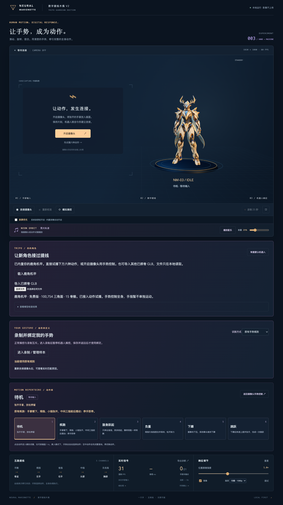

# Neural Marionette Next

两人协作开发的新项目，以已发布的 V2 鹿角机甲为起点。当前应用仍是手势操控 3D 机器人的可运行基线；儿童互动绘本 MVP 的三模块方案与协作计划见下方产品文档。

**首次接手请阅读 [HANDOFF.md：伙伴初始化与项目交接手册](HANDOFF.md)。**

可以直接把 HANDOFF.md 文件发给开发伙伴；其第 2 节按首次接手顺序说明仓库邀请、环境准备、三种克隆情况、启动验收与首个分支，不依赖此前聊天。

## 克隆与运行

需要 Node.js 22.12 或更高版本，以及此私有仓库的访问权限。

```sh
git clone https://github.com/wwlwgo/neural-marionette-next.git
cd neural-marionette-next
npm ci
npm run dev
```

打开 **http://127.0.0.1:5180/**。命令均在本仓库根目录运行，不需要再进入 `neural-marionette-v2` 子目录。先关闭摄像头试播六种动作，再测试真人手势。

GitHub 登录可使用 GitHub Desktop，或已安装的 GitHub CLI 执行 `gh auth login`。首次克隆遇到认证失败，应确认账号已接受仓库协作邀请；不要把账号密码或令牌写进仓库 URL。

macOS 安装依赖后也可双击 `启动数字提线木偶.command`。在运行服务的终端按 Ctrl+C 停止。原项目 V2 使用 5179，新项目使用 5180，浏览器样本不会自动迁移。

## 基线功能

- Tripo 鹿角机甲与原机器人切换，本地导入兼容的已绑骨 GLB。
- 六种动作：待机、疾跑、旋身跃起、负重、下蹲、跳跃。
- MediaPipe 手部追踪、内置手势、个人手势录制与混合识别。
- 正常操控与录制模式互斥，本地背景音乐和舞台录像。
- GLB、Blender 源文件、模型来源和哈希记录随项目提供。



截图来自 V2 基线；Next 初始版本主要调整项目组织、端口和协作配置，尚未重新设计界面。

## 验证

```sh
npm test
npm run build
```

当前基线有 65 项 Node 单元测试。GitHub Actions 已配置对 main 推送及 PR 运行依赖安装、单元测试和构建。浏览器与真人验收步骤见 [交接手册](HANDOFF.md)。

## M3 实时施法试演

运行 `npm run dev` 后打开 [M3 独立试演页](http://127.0.0.1:5180/m3.html)。支持鹿角机甲身体跟随、三节点模板施法、能量球托月亮，以及演出组件接口；默认使用合成开发模板，真人效果待试演。接入说明见 [M3 实现与联调](docs/M3_IMPLEMENTATION.md)。原首页继续提供 V2 手部控制。

## 文档

- [儿童互动绘本 MVP 框架与模块接口](docs/PRODUCT_SPEC.md)
- [三模块开发与双人协作计划](docs/PROJECT_STAGES.md)
- [三模块 MVP 接口协议](docs/MODULE_INTERFACES.md)
- [项目交接与协作手册](HANDOFF.md)
- [来源与初始化差异](UPSTREAM.md)
- [技术培训文档](docs/TECHNICAL_TRAINING.md)
- [手势录制说明](docs/GESTURE_STUDIO.md)
- [V2 历史变更](CHANGELOG.md)
- [原始参考需求](docs/ORIGINAL_REQUIREMENTS.md)
- [资源来源与许可记录](assets/licenses/README.md)

历史文档描述原项目；新项目的目录、端口与协作约定以 README 和 HANDOFF 为准。原始参考需求不是本项目已经承诺或实现的功能清单。
