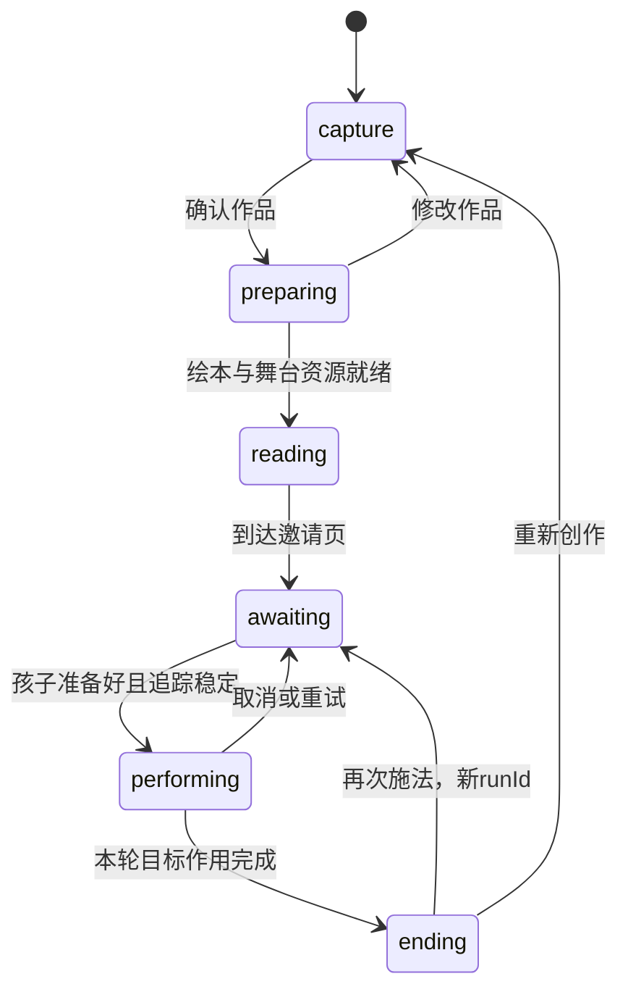

# 儿童互动绘本 MVP：三个模块与协作框架

v0.5 · 2026-10-11。按最新三模块设想重写。接口见 [模块接口协议](MODULE_INTERFACES.md)，实施顺序见 [开发阶段与双人分工](PROJECT_STAGES.md)。旧规划保存在 [v0.4 存档](archive/PRODUCT_SPEC_v0.4.md)。

## 1. 产品结果

孩子先录入一套包含三个动作的大招，观看一段独立生成的 2D 绘本故事，在故事需要帮助时亲自用身体驱动 3D 英雄蓄力、释放，最后回到一页绘本大结局。

**三个主要模块：M1 动作录入、M2 绘本生成与展示、M3 实时 3D 大招。** 一页结局属于 M2，不新增第四个产品模块。轻量流程控制器负责把三个模块串起来。

第一和第三部分复用鹿角机甲、摄像头识别和 3D 演出技术；中间绘本采用独立的文字与图像生成链路。绘本画面不通过录制 3D 舞台获得。

## 2. MVP 范围与默认选择

| 项目 | 首版约定 |
| --- | --- |
| 设备 | 一台带摄像头的桌面电脑，先在 Mac 的目标浏览器验收 |
| 参与人数 | 一个孩子，一位英雄，一套确认大招 |
| 角色 | 复用鹿角机甲；绘本保留鹿角、主色和名称 |
| 故事 | 先做“接住掉下来的月亮”一个主题，可填写英雄名和大招名 |
| 动作 | 孩子亲自录入三个上半身动作；提示“聚拢→拉开→上推”，允许在可识别范围内调整姿态 |
| 录入 | 每个节点单独示范并保持，形成三段样本；支持连续排练和单节点重录 |
| 特效 | 一套参数化能量球，可改名称、颜色、大小；三个节点绑定蓄力、展开、释放 |
| 绘本 | 默认 5 页正文，最后一页为施法邀请，再加 1 页结局；正文页数可配置为 5～10 页 |
| 翻页 | 默认手动，可选自动；到邀请页必须停住 |
| 保存 | 本地保存作品和动作数据；原始摄像头视频默认不保存、不上传 |
| AI | 根据确认作品独立生成绘本文字与插图，资源准备完成后开演 |

“约 10 秒”先作为一种短播放节奏，不与“5～10 页”同时强制验收。首版以分页绘本为准，自动翻页时长可配置，孩子做动作的等待时间不计入绘本播放时长。最后提到的“一页”按一页大结局理解。

**录入孩子自己的姿态样本属于这个 MVP 的必做内容。** 固定动作技术 Demo 只是可复用基础，不能替代录入功能。任意转身、跳跃、连续舞蹈的通用识别、自由生成任意 3D 特效、语音共创、视频导出、多人对战和账号系统留到后续。全身可见时保留跟随，上半身即可完成首版闭环。

## 3. M1：孩子的大招动作录入

页面显示摄像头预览、简单人体点线图、鹿角机甲预览、三个动作卡片，以及录制、重录、排练、确认按钮。点线图显示双手和关键关节是否被识别，提示使用“让双手回到画面”等直接表达。

1. 输入英雄名、大招名和一句愿望，例如“用彩虹能量接住月亮”；选择可用特效颜色。
2. 摄像头就绪，肩、肘、腕稳定可见，完成居中。
3. 依次录入三个动作。每个节点先示范再保持，保存稳定姿态窗口与前后关键点轨迹。
4. 用点线图和 3D 回放检查动作；可单独重录不合格节点。
5. 连续排练一遍：三个节点按顺序识别，特效反馈与正式演出一致。
6. 孩子确认后生成不可变的作品版本，交给绘本生成和 3D 演出。

首版用肩宽/躯干尺度归一化的上半身模板，结合双臂角度、手腕相对肩的位置、手间距和稳定判定。左右采用人体解剖学定义，镜像只影响显示；录入和演出复用同一特征提取器和匹配版本。

每个模板保存多个稳定帧，轨迹用于回放和运动变化判断。第三节点还需验证从第二节点向上推的变化，避免开局举手直接释放。首轮保持时间从约 250 毫秒调起，匹配阈值通过真人排练校准。三个模板过于相似、长期遮挡、或不能驱动现有特效时，提示调整或重录；确认前必须通过排练。

“视频录入”在首版指通过摄像头采样动作。驱动角色回放的是带时间戳的关键点数据；原视频是后续可选能力。动作样本保存在 IndexedDB，作品保存本地引用，刷新后仍可读取；导出需打包样本，不能依赖临时 blob URL。

**边界：**输入摄像头帧、角色与特效模板、已有草稿；输出三个模板、回放数据和确认版本。M1 不生成绘本、不控制正式故事翻页。M1 与 M3 共用追踪、匹配、avatar 和特效代码。

## 4. M2：独立生成并展示 2D 绘本

### 生成链路

输入确认作品的语义摘要：英雄形象与名称、大招名、愿望、颜色、阶段含义、故事主题。孩子的视频、关键点轨迹和骨骼数据留在本地。

生成顺序：分镜与短句 → 同风格插图 → 清单校验 → 资源预加载。默认正文 5 页：“村庄与月亮 → 困难出现 → 英雄想办法 → 大招能帮忙 → 邀请孩子”，另生成一页“月亮回到天空”的结局。

文字由界面独立渲染，不要求图像模型绘制中文。角色参考图、鹿角轮廓、主色、画幅与画风说明贯穿全部插图。图像可单独重试；生成失败保留作品。供应商封装在服务端适配器内，具体模型尚未锁定，API key 由服务端管理。

结局在开演前准备好，因果关系与 3D 目标结果 `moon_restored` 一致。现场参与时不等待模型生成结局。修改作品后产生新确认版本，旧生成任务不会覆盖它。

### 展示链路

播放器负责页图、文字、翻页和进度。正文最后一页包含唯一的 `performanceCue`，停在邀请页并请求进入 M3。场景作用完成后，流程控制器让播放器打开结局页。

**边界：**生成端输入语义摘要，输出故事清单、资源和任务状态；播放器输出邀请事件，接收打开结局的命令。M2 不识别孩子姿态、不计算施法阶段。任何必需资源缺失都不能标为就绪。

占位绘本可用于开发联调；完整 MVP 必须验收至少一套实际生成的 2D 绘本。旁白和 2D 视频动画暂不作为首版必做项。

## 5. M3：孩子实时蓄力与 3D 大招

邀请后先显示“准备好了就开始”。摄像头追踪稳定，角色和特效资源就绪后开启本轮判断。

| 阶段 | 身体输入 | 3D 反馈 |
| --- | --- | --- |
| 等待 | 等待第一模板 | 英雄持续跟随身体，月亮处于等待位置 |
| 蓄力 | 第一节点确认，双手移动 | 小能量球出现，跟随 avatar 双手中点 |
| 展开 | 第二节点确认，双手拉开 | 能量球连续变大，进入可释放状态 |
| 释放 | 第三节点确认且完成上推变化 | 球离开角色双手，独立飞向月亮 |
| 作用完成 | 接触并完成托举 | 发出一次成功结果，返回一页结局 |

角色在释放前持续跟随真人，节点之间也有反馈。真人关键点用于判定，渲染后的角色手部锚点用于特效位置。成功不能只依据“第三动作识别到”或倒计时：必须等特效接触目标并完成托举。

M3 使用 M1 确认的模板和特效版本，不另配隐藏的固定判定规则。追踪丢失时保持当前阶段，暂停节点判断，清空未完成的保持计时；恢复后继续。释放后离开镜头，收尾仍可完成。

**边界：**输入演出配置、本地样本和实时姿态；输出就绪、追踪状态、阶段变化和结果。M3 不生成故事、不操作绘本 DOM。明确标注的自动示范输出 `mode: demo`，不计为孩子亲自完成。重试重置舞台；重录回到 M1 创建新版本。

## 6. 流程控制与边界

控制器由 B 维护，管理作品版本、生成任务、页面切换、摄像头生命周期和每轮 `runId`。

生成失败留在 `preparing` 并可重试。切场景使用同一个摄像头服务，阅读期间可暂停推理，M3 开始前重新检查流与追踪。退出体验关闭媒体流和 Worker；M1 与 M3 不能同时申请两路摄像头。

| 边界 | 传递内容 | 保留在模块内部 |
| --- | --- | --- |
| M1 → M2 | 已确认名称、形象、特效语义、版本 | 原视频、身体轨迹、引擎对象 |
| M1 → M3 | 模板、样本引用、特效与角色配置 | 录入页 DOM 和按钮状态 |
| M2 → 控制器 → M3 | 邀请、作品引用、目标结果、演出配置 | 模型原始响应、翻页实现 |
| M3 → 控制器 → M2 | 本轮结果、作品版本、目标结果标识 | 每帧关键点、粒子与角色实例 |

首版采用 JSON、组件方法和事件，不要求三个微服务。高频姿态和 Three.js 对象保留在本地动作引擎；远端负责绘本生成。精确契约见 [模块接口协议](MODULE_INTERFACES.md)。

## 7. 两人分工

| 负责人 | 主责 | 独立交付 |
| --- | --- | --- |
| A：动作与 3D | M1、M3、摄像头、样本存储、模板匹配、重定向、特效、目标作用 | 录入作品可回放，并可用真人重复施法，输出标准结果 |
| B：绘本与应用 | M2、生成服务、播放器、控制器、作品元信息/版本、加载、转场 | 样例作品生成绘本，邀请调用模拟舞台，收到结果打开结局 |
| 共同 | 协议、fixture、角色风格、联调、儿童试用 | 真实录入→实际绘本→真人施法→一页结局 |

A 提供录入和演出模块，B 提供应用外壳；B 无需改骨骼算法，A 无需等待绘本 API。共享入口、协议、GLB 指定负责人，通过功能分支提交，由另一人试用后合入。A 的任务偏实时算法，B 偏内容生成和应用整合；按各模块通过情况调整辅助任务。

## 8. MVP 验收

1. 录三个动作、单独重录、点线反馈、回放、排练与确认均可使用；刷新后样本可读取。
2. 至少两位不同身高/站位的试演者录入并使用自己的模板，记录误触发与失败原因。
3. 同一确认作品实际生成独立绘本文字与插图，默认 5 页正文＋1 页结局；角色与大招语义一致。
4. 邀请页暂停，只含一次正式 3D 介入；孩子慢做时剧情等待。
5. avatar 连续跟随上半身，三个模板顺序驱动特效；跳过节点、抖动或开局举手不会直接释放。
6. 球离手、接触并托起月亮后才展示结局；重复结果不会重复翻页。
7. 遮挡可恢复；生成失败、图片缺失、摄像头未授权有可执行的恢复入口。
8. 连续完成三轮，舞台、节点、计时与去重正确；旧任务/事件不会覆盖新版本或新一轮。
9. 占位故事、自动示范与真实摄像头验收分别记录，示范不计为孩子完成。

首轮性能以目标机器约 30 FPS、动作反馈可感知延迟约 200 毫秒以内为调试目标，记录设备和方法后调整；这些数值不是当前能力的确认结论。

## 9. 现有基础与待新增项

依据同项目“brainstorming”、前序产品规划聊天和 [Next 交接手册](../HANDOFF.md)。本次以最新三模块需求为准。

`energy-avatar` 已有鹿角机甲、身体跟随、固定三节点、能量球和月亮效果；`stick-avatar` 可辅助核对识别。现有 `spell.js` 是固定规则，`effects.js` 有阶段事件；它们尚不等于自录模板识别和标准成功协议，真人表现仍需实测。

待新增：录入与持久化、模板匹配、组件适配器、绘本生成/播放器、流程与版本绑定、资源检查和完整真人验收。历史四小时技术 Demo 的预算不作为完整 MVP 工期承诺。先按阶段完成闭环，再依据录入匹配与图像生成实测估算工期。
