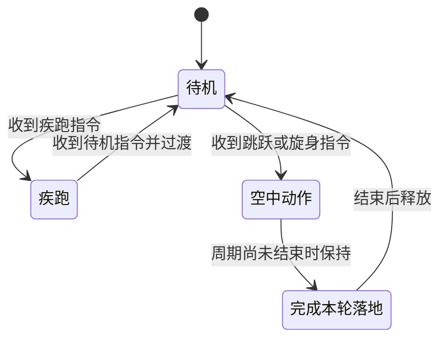

> 公开版本不附带历史测试截图、视频和诊断数据；文中相关路径仅说明本地开发记录位置。V2 差异以 V2 README 为准。

# 从黑盒到白盒：数字提线木偶技术拆解课

> 面向第一次接触计算机视觉、浏览器 3D 和手势交互的读者。以本仓库实际代码为主线，不要求先学会编程。
>
> 代码基线：`6907367`，包含手势录制与混合模式。编写日期：2026-09-14；第 7 课已于 2026-09-15 随长录制与持续疾跑更新。下文的数值是对应版本的实现或配置，不是硬件性能保证。阅读本文无需启动项目；实验部分供之后动手使用。

## 如何阅读，以及为什么选 Markdown

这份教程选择 **Markdown 作为主文档**：文字、代码、表格和流程图可以与项目一起放进 Git，后续实现发生变化时，能看清解释也改了哪里。HTML 更适合交互滑块、可播放的时间轴和动画课件，但需要额外维护页面代码。本阶段先建立一份可以随时查阅的技术说明。

本文按“发生了什么 → 为什么这样设计 → 技术如何实现 → 到哪里看代码”的顺序展开。公式属于选读内容，不必先理解公式才能理解项目。代码块若标为“教学示意”，用于说明思想，不能直接替换源码。

建议分三次阅读：第一次读 1–4 课，建立系统地图；第二次读 5–10 课，理解识别与动画；第三次读 11–15 课，学习调试、工程方法和扩展方式。

### 课程目录

1. [把一次手势拆成六件事](#lesson-1)
2. [方法论、架构、框架和技术栈分别是什么](#lesson-2)
3. [网页为什么能成为一个本地应用](#lesson-3)
4. [MediaPipe：把画面变成手部关键点](#lesson-4)
5. [Web Worker 与 WASM：计算在哪里发生](#lesson-5)
6. [从关键点到手势：规则识别](#lesson-6)
7. [录制自己的手势：归一化与 DTW](#lesson-7)
8. [混合模式与状态机：谁决定机器人当前做什么](#lesson-8)
9. [机器人为什么能动得协调](#lesson-9)
10. [Three.js 与 Canvas：画面怎样组成](#lesson-10)
11. [推理时间、帧率与响应延迟](#lesson-11)
12. [数据、文件、版本与测试](#lesson-12)
13. [项目迭代背后的方法论](#lesson-13)
14. [TouchDesigner 与真实 Agent 扩展](#lesson-14)
15. [练习、代码导航与自测](#lesson-15)

---

<a id="lesson-1"></a>
## 第 1 课：把一次手势拆成六件事

你在镜头前摆动手指，机器人开始疾跑，看起来像发生了一次魔法。实际上，系统依次完成了几项职责明确的工作：

| 环节 | 系统需要回答的问题 | 输入 → 输出 | 本项目负责人 |
| --- | --- | --- | --- |
| 采集 | 摄像头此刻看到了什么？ | 真实场景 → 一帧图像 | 浏览器摄像头 API |
| 感知 | 手在哪里，各个关节在哪里？ | 图像 → 21 个关键点 | MediaPipe Hand Landmarker |
| 解释 | 这些点的排列和运动代表哪个指令？ | 关键点序列 → 候选动作 | 内置规则、个人样本匹配 |
| 决策 | 现在能否切换？是否先完成落地？ | 动作指令、当前状态 → 有效动作 | 混合路由、ActionDirector |
| 动画 | 这个动作在此刻应摆成什么姿势？ | 动作、时间 → 身体位置和关节角度 | 程序化动画、腿部 IK |
| 呈现 | 怎样把它显示给用户？ | 3D 场景、摄像头、提线 → 屏幕画面 | Three.js、Canvas 2D、网页界面 |

```mermaid
flowchart TD
    A[真实手部与摄像头] --> B[一帧图像]
    B --> C[Worker 中的 MediaPipe]
    C --> D[21 个关键点]
    D --> E[内置手势规则]
    D --> F[个人轨迹样本匹配]
    E --> G[混合模式选择动作指令]
    F --> G
    G --> H[动作控制器：切换与完成落地]
    H --> I[姿势计算与腿部 IK]
    I --> J[Three.js 渲染机器人]
    D --> K[骨架与提线投影]
    J --> L[Canvas 合成最终画面]
    K --> L
    B --> L
```



不支持 Mermaid 的阅读器仍可按上方表格理解流程：**图像 → 坐标 → 指令 → 姿势 → 画面**。

### 跟踪一次“我的疾跑手势”

假设你已经录制并绑定疾跑，现在重新做它：

1. 浏览器取得新摄像头帧，把缩小后的图像交给 Worker。
2. MediaPipe 返回手腕、指节和指尖的位置；它此刻没有返回“疾跑”。
3. 个人匹配器积累最近一小段位置变化，与保存的疾跑轨迹比较。
4. 如果足够相似，且连续确认后没有歧义，匹配器输出 `action: 'run'`。
5. 混合路由优先采用这个个人动作指令。
6. 动作控制器进入疾跑：先短暂蹲压，然后前冲并进入跑步循环。
7. 动画计算身体高度、脚的位置、手臂摆动和躯干倾斜；Three.js 将姿势画出来。

你录制的手势与机器人的跑步姿势是两份不同的数据。前者决定“什么时候跑”，后者决定“怎么跑”。这就是后来只改识别方式，却能保留原有华丽动作的原因。

**这一课应记住：机器人不是直接模仿你的五根手指；手势主要用来选择预先设计好的全身动作。**

<a id="lesson-2"></a>
## 第 2 课：方法论、架构、框架和技术栈分别是什么

这些词经常被混着使用，但它们处在不同层次。

| 概念 | 用普通话解释 | 本项目的例子 |
| --- | --- | --- |
| 方法论 | 遇到问题时怎样拆解、验证、迭代 | 把识别与动画分开测试；让用户示范手势；先测量再调参 |
| 架构 | 工作怎样分层、数据怎样流动 | 摄像头 → Worker 感知 → 主线程解释与动画 → 屏幕 |
| 框架／库 | 别人封装好的可复用能力 | MediaPipe 提供视觉任务接口；Three.js 提供 3D 对象与渲染能力 |
| API | 程序请求另一项能力的约定入口 | `getUserMedia()` 请求摄像头；`postMessage()` 发送线程消息 |
| 算法 | 一项计算的具体步骤 | DTW 比较两段轨迹；IK 根据脚的位置反推腿部角度 |
| 模型 | 由训练得到、用于预测的数据与计算结构 | `hand_landmarker.task` 中的预训练手部模型资源 |
| 技术栈 | 为完成项目组合使用的技术集合 | JavaScript + MediaPipe + Worker + Three.js + Vite 等 |

严格说，本项目没有采用 React、Vue 这样的界面框架。界面使用原生 HTML、CSS 和 JavaScript，直接管理按钮、下拉框与状态文字。也没有使用现成游戏引擎的动作编辑器；动作规则和动画控制由项目代码实现。

### 技术栈全景

| 技术 | 类别 | 本项目做什么 | 在什么时候运行 |
| --- | --- | --- | --- |
| HTML | 页面结构 | 定义舞台、视频元素、控件与面板 | 浏览器 |
| CSS | 页面样式 | 排版、颜色、响应式布局 | 浏览器 |
| JavaScript / ES Modules | 编程语言与模块机制 | 连接所有功能，按文件拆分逻辑 | 浏览器；工具脚本也用 Node.js 执行 |
| MediaPipe Tasks Vision `0.10.32` | 计算机视觉库 | 调用 Hand Landmarker，提取手部关键点 | 浏览器 Worker |
| 预训练 `.task` 模型 | 模型资源 | 提供手部检测与关键点估计所需模型 | Worker 内加载 |
| Web Worker | 浏览器并发机制 | 把视觉推理从页面主线程移走 | 浏览器 |
| WebAssembly / WASM | 编译代码的运行格式 | 执行 MediaPipe 提供的计算模块 | Worker 内，当前指定 CPU |
| Three.js `0.180.0` | JavaScript 3D 库 | 机器人几何、骨骼层级、灯光、材质和渲染 | 浏览器主线程组织，WebGL 提交图形工作 |
| WebGL | 浏览器图形 API | 让渲染器使用图形硬件绘制 3D | 浏览器与 GPU |
| Canvas 2D | 二维绘图 API | 合成视频、机器人、骨架、提线与文字 | 浏览器 |
| requestAnimationFrame | 浏览器动画调度 API | 在刷新周期中更新与绘制 | 浏览器主线程 |
| localStorage、JSON | 本地存储与数据格式 | 保存、备份和恢复个人手势样本 | 浏览器／导出文件 |
| MediaRecorder、Blob | 媒体录制与二进制数据 API | 编码舞台视频、生成下载文件 | 浏览器 |
| Node.js、npm | 开发运行环境与包管理 | 安装依赖、准备资源、运行开发工具与测试 | 本机终端 |
| Vite `7.3.6` | 开发与构建工具 | 启动开发服务、处理模块、构建发布文件 | 本机开发／构建阶段 |
| Node 内置测试工具 | 单元测试 | 检查手势、状态、轨迹和动画计算 | 测试阶段 |
| Python + Playwright | 浏览器自动测试 | 操作网页，检查录制、切换、恢复等流程 | 测试阶段，普通运行不需要 |
| FFmpeg | 辅助媒体工具 | 整理演示录像等开发产物 | 需要处理媒体时，不在实时控制链路中 |
| Git / GitHub | 版本管理／远程托管 | 保存历史、分享代码和文档 | 开发协作阶段 |

版本来自 [package.json](../package.json)，安装由 [package-lock.json](../package-lock.json) 锁定。这是本项目使用的版本，不是在宣称它们是最新版本。Vite 的间接依赖还包括 esbuild、Rollup 等工具；它们负责内部转换和打包，应用没有直接调用它们识别手势。

<a id="lesson-3"></a>
## 第 3 课：网页为什么能成为一个本地应用

### 3.1 三种文件怎样配合

可以把 HTML 理解为“有哪些东西”，CSS 理解为“东西摆在哪里、长什么样”，JavaScript 理解为“点击或收到数据以后发生什么”。

以“录制我的手势”按钮为例：HTML 提供按钮，CSS 给它大小和颜色，JavaScript 监听点击事件，启动倒计时，收集关键点并更新回放面板。

这里的 **DOM** 是浏览器把 HTML 解析成的对象树。代码通过 `document.getElementById()` 找到按钮或文字，再设置内容、绑定事件。无需额外界面框架，也可以完成这些操作。

### 3.2 Node.js 与浏览器中的 JavaScript

两者都能运行 JavaScript，但能访问的环境不同。

- 浏览器中的 JavaScript 可操作页面，经过许可访问摄像头。
- Node.js 在终端中运行，适合读写项目文件、启动工具、安装和构建资源。

本项目中的 Node.js 负责“把应用准备好并送到浏览器”。实时手部推理并没有发给一个 Node.js 后台服务处理。

### 3.3 Vite 到底干什么

Vite 是开发与构建工具。开发时提供本地服务器并处理模块加载；构建时整理源码与资源，生成可以部署的文件。它不是视觉模型，也不决定机器人的动作。这里按项目使用的 Vite 7 解释。[Vite 7 入门](https://v7.vite.dev/guide/)、[生产构建](https://v7.vite.dev/guide/build)

从仓库根目录进入 `neural-marionette/` 后，各命令的含义是：

| 命令 | 通俗解释 | 会产生什么 |
| --- | --- | --- |
| `npm ci` | 按锁定清单安装依赖 | `node_modules/` |
| `npm run assets` | 准备浏览器要用的视觉资源 | 本地 bundle、WASM、模型清单；模型不存在时下载 |
| `npm run dev -- --port 5173 --strictPort` | 启动开发服务 | 可在本机访问的开发页面 |
| `npm test` | 执行自动测试 | 测试通过或失败报告 |
| `npm run build` | 把开发文件整理为发布文件 | `dist/` |
| `npm run preview -- --port 5173 --strictPort` | 本机检查构建结果 | 构建版预览服务 |

`npm run xxx` 的含义由 `package.json` 的 `scripts` 定义。`--` 后的参数传给对应工具。`strictPort` 要求使用指定端口，端口被占用时报告错误，避免悄悄换地址导致你找不到原来的手势样本。

### 3.4 localhost、“本地”和“离线”

`127.0.0.1` 是当前电脑的回环地址，`:5173` 是服务端口。本地 HTTP 服务器负责提供文件；浏览器读取这些文件后，在本机运行程序。

“有一个网址”不意味着“计算发生在云端”。本项目首次安装依赖可能联网，缺少模型时也需要下载；资源齐备后，实时使用不调用云端推理。

摄像头访问需要许可与安全上下文，浏览器将 localhost 等本机环境特殊对待；对外部署通常使用 HTTPS。不要直接用 `file://` 打开项目 HTML。[MDN：getUserMedia](https://developer.mozilla.org/en-US/docs/Web/API/MediaDevices/getUserMedia)

停止 Vite 服务意味着停止提供文件；它不是终止所有已加载网页脚本的保证。结束真人使用时也应点击页面「关闭摄像头」或关闭页面。本项目另外在页面进入后台、离开页面时释放摄像头资源。

<a id="lesson-4"></a>
## 第 4 课：MediaPipe——把画面变成手部关键点

### 4.1 为什么不能直接读取“食指坐标”

摄像头输出的是像素：哪里亮、哪里暗、什么颜色。像素本身不带“这是食指”的标注。**计算机视觉**要解决的，就是从图像中推断有用结构。

MediaPipe 是 Google 提供的一组端侧感知能力。本项目具体使用 **Hand Landmarker**，即手部关键点定位任务；没有调用 MediaPipe 的 Gesture Recognizer 来直接输出六种机器人动作。[官方 Hand Landmarker 概览](https://developers.google.com/edge/mediapipe/solutions/vision/hand_landmarker)

### 4.2 它内部做了什么

用简化方式理解：先定位手掌区域，再估计手部关节；视频模式可以利用前面的追踪结果，避免每帧都重新搜索整张画面。当跟踪或手部存在判定失败时，会重新触发检测。具体细节由库负责，我们通过接口使用它。[官方 Web 配置说明](https://developers.google.com/edge/mediapipe/solutions/vision/hand_landmarker/web_js)

如想继续了解模型设计背景，可读开发团队的 [MediaPipe Hands 论文](https://arxiv.org/abs/2006.10214)。该论文用于理解思路；不能把早期论文里的性能数字当成本项目当前设备的测量结果。

### 4.3 21 个关键点是什么

每个点都有固定编号，程序才能跨帧知道“这一帧的食指尖”对应“上一帧的食指尖”。

| 编号 | 对应位置 |
| --- | --- |
| `0` | 手腕 |
| `1–4` | 拇指链条，`4` 是指尖 |
| `5–8` | 食指链条，`8` 是指尖 |
| `9–12` | 中指链条，`12` 是指尖 |
| `13–16` | 无名指链条，`16` 是指尖 |
| `17–20` | 小指链条，`20` 是指尖 |

单个点可以写成这样的教学示意：

```js
{ x: 0.60, y: 0.35, z: -0.04 }
```

`x`、`y` 分别按画面宽高归一化，通常位于 0 到 1；`z` 表示相对手腕的估计深度，尺度大致参照 `x`，不是摄像头测得的米数。本项目用的是 `landmarks`，没有使用输出中的 `worldLandmarks`。[官方结果格式](https://developers.google.com/edge/mediapipe/solutions/vision/hand_landmarker/web_js)

例如 1280 × 720 的画面中，上例约对应横向 768、纵向 252 像素；镜像显示时还要左右翻转。这些只是帮助理解的示例数值。

### 4.4 什么叫模型、训练和推理

- **训练**：用大量例子调整模型参数，让它学会从画面预测关键点。这里使用的是已经训练好的模型。
- **模型文件**：保存预测所需的数据与结构，本项目的入口文件是 `hand_landmarker.task`。
- **推理**：将一张新图像交给已有模型，计算这一张图像中的手部位置。

所以界面里的 26–47 毫秒，说的是一次已有模型的计算耗时。项目没有在此时询问大语言模型，也没有重新训练模型。

### 4.5 配置与误解

当前只取一只手；检测、存在、跟踪阈值分别为 `0.65`、`0.65`、`0.60`。这些是内部判定门槛，不代表“机器人动作正确率是 65%”；其中跟踪阈值的官方定义是相邻帧手部框的 IoU 门槛。IoU 可理解为两个区域重叠面积与合并面积的比例。[官方阈值定义](https://developers.google.com/edge/mediapipe/solutions/vision/hand_landmarker/web_js)

界面显示的左右手分类分数，也不能当成疾跑的置信度。感知层能看出一只手，不等于动作层已经理解用户想做什么。

**源码入口：** [tracker.worker.js](../public/tracker.worker.js)、[app_config.json](../config/app_config.json)。

<a id="lesson-5"></a>
## 第 5 课：Web Worker 与 WASM——计算在哪里发生

### 5.1 主线程像前台，Worker 像独立工作台

主线程需要响应按钮、更新页面、准备动画。如果在它上面做一次耗时较长的同步计算，这段时间页面可能无法及时响应。

Web Worker 提供独立的 JavaScript 执行环境，通过消息与主线程交流；它不能直接操作页面 DOM。Worker 是浏览器机制，不是云端服务器，也不是会自己制定计划的 AI Agent。[MDN：Web Workers](https://developer.mozilla.org/en-US/docs/Web/API/Web_Workers_API/Using_web_workers)

本项目将 MediaPipe 放到 Worker，因为 `detectForVideo()` 是同步调用。调用者要等它完成；放进 Worker 后，等待发生在 Worker 中，主线程仍可继续组织画面。[MediaPipe Web 运行说明](https://developers.google.com/edge/mediapipe/solutions/vision/hand_landmarker/web_js)

```text
主线程                         Worker
  │ 初始化配置 ────────────────→ │ 加载模型和 WASM
  │ ←───────────────── ready   │
  │ ImageBitmap + 时间戳 ──────→ │ detectForVideo()
  │ 继续更新动画                 │ 计算手部关键点
  │ ←────────── 21 点 + 耗时     │
  │ 更新手势判断                 │ 释放此帧图像
```

手势规则、个人轨迹匹配和动画控制仍在主线程。我们没有把整个应用都搬进 Worker。

### 5.2 WASM 做什么

WebAssembly，简称 WASM，是浏览器可以执行的编译代码格式。它允许某些底层计算以编译模块形式运行，并与 JavaScript 配合。项目直接使用 MediaPipe 附带的 WASM，没有自己写 C++ 或编译推理引擎。[MDN：WebAssembly 概念](https://developer.mozilla.org/en-US/docs/WebAssembly/Guides/Concepts)

把几个容易混淆的名字放在一起：

| 名字 | 负责的问题 |
| --- | --- |
| MediaPipe | 怎样从图像估计手部结构 |
| `.task` 文件 | 加载哪份预训练模型资源 |
| WASM | 如何在浏览器中执行对应的编译计算模块 |
| Web Worker | 把这段计算放在哪个执行环境，减少主线程阻塞 |
| WebGL / GPU | 怎样绘制机器人 3D 画面 |

当前代码明确写了 `delegate: 'CPU'`。所以“画机器人使用 GPU”与“手部推理使用 CPU”可以同时成立。WASM 本身也不等于 GPU 加速。

### 5.3 为什么只允许一帧正在推理

当前摄像头目标为 30 FPS，即理想情况下约每 33.3 毫秒产生一帧。如果处理一帧要 47 毫秒，却不停把所有帧排队，系统会越来越落后，最后处理的都是过去的动作。

我们使用 `busy` 标记：上一帧未返回时，不派发下一帧；空闲后再取当前的视频图像。同时检查视频时间，避免重复处理同一帧。这叫**背压控制**：下游忙时限制上游派发。它减少积压，不会把一次 47 毫秒的计算自动变成 10 毫秒。

图像通过 `createImageBitmap()` 生成，宽度缩到 640 像素并保持比例，然后用 `postMessage(..., [bitmap])` 转交给 Worker。转移意味着接收方接管资源；不要简单认为所有可转移对象都保证完全零拷贝。处理完成后调用 `close()` 释放资源。[MDN：可转移对象](https://developer.mozilla.org/en-US/docs/Web/API/Web_Workers_API/Transferable_objects)

**源码入口：** [main.js](../src/main.js) 的 `dispatchFrame()`、`startCamera()`；[tracker.worker.js](../public/tracker.worker.js)。

<a id="lesson-6"></a>
## 第 6 课：从关键点到手势——规则识别

### 6.1 先提取特征，再做判断

关键点是一串数字。**特征工程**是把这串数字转换成更接近问题含义的量，例如“食指是否伸直”“两指距离多大”“手腕转得多快”。

本项目内置规则提取的特征包括：

| 特征 | 怎样得到 | 用来做什么 |
| --- | --- | --- |
| 手掌尺度 | 手腕到中指根部的距离 | 把距离、速度换算成相对手掌大小 |
| 手指伸直程度 | 比较指节方向，以及指尖相对手腕的距离 | 区分张手、握拳、双指、单食指 |
| 捏合距离 | 拇指尖与食指尖距离 ÷ 手掌尺度 | 识别负重 |
| 指尖朝向 | 指根到指尖方向是否朝画面下方 | 区分疾跑手型 |
| 手腕速度 | 相邻帧位置变化 ÷ 时间间隔，再按手掌尺度归一化 | 下压、上提、摆动 |
| 转动速度 | 手掌方向角的变化 ÷ 时间间隔 | 旋身跃起 |
| 尺度变化 | 手掌大小比值的对数变化 | 作为前后靠近摄像头的运动线索 |

这里的前后移动只是从画面变化推断出的线索。倾斜手掌也会改变画面尺度，因此它不能替代真实的深度传感器。

### 6.2 为什么要归一化

假设同一种捏合，在近处两指间隔 40 像素，远处只有 20 像素。如果直接写“距离小于 30 像素”，同一动作就会因远近改变结果。

改成“两指间距 ÷ 手掌长度”，相同姿态在不同距离下更接近。归一化减少位置和大小的影响，但不能保证任何角度、任何遮挡下都一样准确。

内置规则主要使用归一化画面的二维坐标。后来的个人匹配器还加入画面宽高比补偿，两套特征提取实现并非完全相同。

### 6.3 伸直判断用了什么数学

代码比较两段指节向量的方向。如果它们大致同向，通常说明指头更接近伸直；再辅以指尖距离条件。

选读公式：

```text
方向相似度 = (向量 a · 向量 b) / (a 的长度 × b 的长度)
```

这是向量夹角的余弦。接近 1 说明同向，接近 0 说明垂直。实际代码用门槛进行判断，而不是精确重建每一个指关节的生理解剖角度。

### 6.4 从特征拼出手势

以内置疾跑为例，逻辑可概括为：

```text
拇指和小指保持伸开
中间三指可自由伸屈，不要求固定姿态
并且最近约 360 ms 的食指、中指、无名指运动中，至少两指达到门槛
并且判断持续足够久
→ 疾跑指令
```

内置疾跑将图像宽高比与估计深度统一后，用手腕及掌指关节建立手掌自身的三维坐标系，减少手掌俯仰、整手平移和缩放对运动判断的影响。中间三指各自的近端、中段、指尖相对其根部变化决定是否在摆动。至少两指运动用于容忍第三指较弱或不同步；不需要三指精确同步。估计深度不是精密深度传感器，遮挡或模型误差仍会影响结果。

旋身则要求只伸食指并产生转动。两者使用互斥手型，降低串扰。手型从疾跑类换成旋身类时，代码清空上一类积累的运动信息，避免把刚才的摆动误当成新的转腕。

这个转腕判断使用手腕到中指根部连线的二维方向变化。它并不完整测量手腕绕三条轴的真实旋转；某些“转钥匙”动作若主要发生在镜头深度方向，仍可能不好识别。

### 6.5 为什么不能每帧立刻切换

摄像头点位会抖动，手势边缘也会模糊。如果每一帧都切动作，机器人可能在跑、转、待机之间频繁闪换。

我们用了几类时间处理：

- **平滑**：速度逐步变化，降低单帧跳动。视觉骨架还另有点位滤波。
- **候选确认**：普通动作候选维持约 80 毫秒、旋身约 65 毫秒后确认；这是代码门槛，实际确认受采样时刻影响。
- **迟滞**：进入与退出使用不同条件。例如捏合进入负重的距离门槛是 0.25，保持负重时放宽到 0.38，避免在边界反复进出。
- **短暂保持**：摆动或旋转在短时间内暂时变弱，不立即结束动作。
- **一次性触发锁**：一次跳跃完成后，持续保持同一输入不会自动无限跳。

选读平滑公式，来自 `approach()`：

```text
新值 = 当前值 + (目标值 − 当前值) × (1 − exp(−dt / tau))
```

`dt` 是经过的时间；`tau` 越大，变化越平缓，也越容易感觉拖后。平滑是一种有代价的取舍。

注意：内置手势和个人匹配使用原始关键点，内置规则自己平滑速度；显示骨架与小幅位置跟随使用另外的滤波链路。不要把所有延迟都归到同一个“平滑系数”。

### 6.6 校准、死区与丢手恢复

**校准**是在你稳定放好手时，记录一份中立参考。后面的横向位置跟随与头部小幅修饰相对这个参考计算。当前代码收集 8 个稳定样本，检查手腕与食指尖变化，再求平均参考；它不会修改 MediaPipe 模型，也不会把手势样本重新训练一遍。

**死区**是在中立位置附近留一点容忍范围。微小抖动落在范围内时，不用让机器人跟着晃。平滑是“逐渐追上变化”，死区是“很小的变化暂不响应”，两者作用不同。

**追踪建立与丢失**也需要时间判断：连续检测到 5 帧后建立连接，超过约 250 毫秒看不到手则释放追踪。重新获得手时重建参考，减少把重新入镜的位置突然当成大幅控制量。各层有自己的状态，动作中的完整落地仍按控制器的周期完成。

**源码入口：** [actions.js](../src/actions.js) 的 `handFeatures()`、`GestureInterpreter`；[core.js](../src/core.js) 的 `approach()`、`LandmarkFilter`。

<a id="lesson-7"></a>
## 第 7 课：录制自己的手势——归一化与 DTW

### 7.1 为什么从“描述手势”改成“示范手势”

“食指和中指向下，前后摆动”对人来说很自然，对程序却缺少很多信息：手掌朝哪边？摆动多大？主要是手腕还是指尖动？所谓前后，是画面上下还是朝向镜头？

内置规则需要把这些含糊描述翻译成门槛。个人录制则让用户提供实际例子。这种方式可以称为**基于示范的交互定义**：用展示行为减少语言解释的歧义。

但它仍有边界：示范必须先经过 MediaPipe。如果原始关节位置估计错了，保存下来的也是错误轨迹。

### 7.2 录下来的究竟是什么

当前录制模块先准备 3 秒，等待完整手掌持续可见约 0.3 秒后，才开始默认 6 秒的完整采样（可选 4 / 8 秒）。等待不占采样时间，疾跑需示范多个重复周期。保存的是下面这样的结构，示意省略了其他点和帧：

```js
{
  action: 'run',
  frames: [
    { t: 0, aspect: 16 / 9, points: [ /* 21 个 x、y、z */ ] },
    { t: 50, aspect: 16 / 9, points: [ /* 下一帧 */ ] }
  ]
}
```

`t` 是相对采样时间，`aspect` 是视频宽高比。保存后另外带有编号和创建时间。这里没有像素视频，更没有把疾跑动画保存在这份轨迹里。

质量检查包括：至少 16 帧、有效跨度至少 1 秒、连续丢手不超过 250 毫秒、开始结束附近有手、坐标完整且有限值；「持续摆动」方式的新疾跑样本还需有足够运动量，「保持手型」方式允许稳定姿态。样本格式升级为版本 2，同时仍可导入版本 1。检查的目的是避免用残缺片段建立绑定。

### 7.3 把一只手变成“可比较的数字摘要”

直接比较两个视频画面成本高，也容易被背景、衣服、光线影响。我们已经有关键点，因此只比较与手势有关的结构和运动。

当前每个时刻提取 **30 个数**：

- 选取 9 个代表性关节点，每点 3 个相对坐标，共 27 个数。
- 加上手腕相对起点的横向移动、纵向移动、手掌尺度变化，共 3 个数。

处理过程是：

1. 以手腕为局部原点，减去手腕位置，让手放在画面左边或右边更可比。
2. 横坐标结合画面宽高比修正，减少横纵尺度不一致的影响。
3. 除以手掌尺度，降低远近造成的整体大小差异。
4. 深度分量降低权重，因为它只是估计值。
5. 保留手腕随时间的位移与尺度变化，避免把“动起来”也一起归一化掉。

有一项刻意保留：**手掌朝向**。我们没有把任意旋转全部抹平，否则带有不同朝向含义的自定义手势可能失去区别。代价是使用时改变角度较大，可能需要补录。左右手也没有自动统一为同一份个人模板。

这里的“30 维特征向量”只是把 30 个数排在一起。它不是文本向量嵌入，也没有连接向量数据库。

### 7.4 为什么对时间轴重采样

你录制时可能采到 32 帧，再做一次时可能只采到 25 帧。不能简单拿“第 10 帧”互相比较，因为两者可能处于不同进度。

对于使用 DTW 的动作，我们先把片段重采样成 12 个均匀时间点；落在两帧之间的位置用插值估计。这样不同帧数都有相同长度的摘要，也控制了计算量。12 是当前工程选择，并不是手势识别的理论标准。

除了整段样本，还从样本切出约 800 毫秒的小片段，最多保留 8 段用于 DTW。当前动态疾跑使用另一条路径：每份录制保留整段及最多 9 个约 1.25 秒局部片段。各片段最多取 128 个均匀时刻，统计姿态均值和运动幅度。长录制里缓慢转腕或位置漂移不再全部混入唯一一组平均特征，实时窗口可以匹配其中实际示范过的某一局部变化。

### 7.5 DTW 是什么

DTW 的全称是 Dynamic Time Warping，通常译为**动态时间规整**。它让两段序列在时间轴上做有限的拉伸或压缩，寻找成本较小的对应关系。

想象同一段节奏：

```text
示范：抬起 → 移到中间 → 落下
重做：抬起 → 稍停 → 移到中间 → 落下
```

若强迫第 2 个时刻对应第 2 个时刻，稍停会造成较大差异。DTW 允许某一段多对应几个时刻，让动作顺序相近但速度略有不同的两次示范仍能接近。

选读：当前实现的核心递推可以写成：

```text
累计成本(i, j) = 当前两个特征的距离
                + min(左边累计成本, 上边累计成本, 左上累计成本)
```

每对特征的距离由各维差值计算。代码还把对齐路径限制在索引差不超过 4 的带状范围内，防止过度拉伸，并用序列长度缩放最终成本。这是项目自己实现的短序列 DTW，没有引入第三方 DTW 包。

DTW 不理解“跑步”这个词。它只知道一段数字序列与另一段数字序列有多相似，动作含义来自你保存时选择的 `action` 标签。

### 7.6 在线识别如何运转

实际使用时，系统保留最近约 1.9 秒数据，尝试 500、850、1250、1750 毫秒的不同窗口；有效窗口至少包含 9 帧、跨越约 400 毫秒。匹配最多约每 120 毫秒计算一次。

对于非疾跑动作，每个实时窗口与已存模板比较，得到分数：

```text
分数 = DTW 距离 + 1.5 × 两段运动幅度的差值
```

疾跑默认采用**食指运动**：样本识别支持手型，不约束食指的具体位置；第 6、7、8 号关键点减去食指掌指关节的位置，再转入手掌坐标系并按掌宽／掌长归一化。最近约 280 ms 的变化用于判断食指是否在动，启动／停止门槛分别为归一化活动量 0.030／0.020。整手平移、平面旋转和缩放不应冒充食指弯曲；停指不额外保持疾跑。它仍依赖 MediaPipe 输出中能看到真实运动。

另外保留两种可选方式。**保持手型**使用最近约 400 ms 的手型均值，与录制的整段及局部手型比较，不要求持续运动；换手型经过短暂确认后退出，丢手超过 250 ms 清空状态。设置与样本一起保存为 `runTrigger: "pose"` 或 `"motion"`，旧库缺少设置或使用此前保持手型默认时迁移为 `"finger"`。新的选择保存 `runControlVersion: 2`，下次打开保持不变。

**持续摆动**的动态疾跑则使用：`27 维手型均值距离 + 0.65 × 30 维运动标准差距离`。前者比较手的大致形状，后者比较哪些手指、手腕在动以及幅度。每个实时窗口分别与录制中的多个片段特征比较，取满足手型和运动门槛的最近距离。这样从摆动的一半开始观察，也不必强迫它对齐录制的第一下。除整体手型差异外，还检查代表关节的最大偏差，防止拇指或小指明显收起时被整体平均值掩盖。这是项目自定义的周期动作匹配，不是另一个预训练模型；它也无法完整保留运动顺序，形状和幅度相近的动作仍可能混淆。旧的近乎静态疾跑样本为兼容性保留原 DTW 路径，建议重录为有运动的样本。

两条路径都是分数越小越接近。界面“识别宽松度”默认 `0.28`，它是这套距离量度下的门槛，不是 28% 的概率，也不是通用机器学习置信度。

此外还有几道判断：

- 运动模板不能被几乎静止的同款手型轻易触发。
- 最好的两个动作都通过门槛，且分数相差不到 `0.045` 时，视为难以区分，候选回到待机。
- 非待机候选需要保持至少约 `110 ms`；待机候选约 `180 ms`。疾跑时，如果最近 400 ms 仍有运动且手型相近，可将短暂失配的退出确认延长到约 `450 ms`，同时适度放宽维持门槛，减少跑两步就停。停手或换手型不获得这段额外宽限。实际变化发生在后续有效采样中。
- 丢手超过 `250 ms` 时清空匹配状态。

因此“候选尚未通过”或“出现歧义”不一定当帧就让当前动作消失：还有短暂退出确认，动作控制器也可能先完成落地。

### 7.7 这套办法好在哪里，局限在哪里

| 优点 | 对应局限 |
| --- | --- |
| 一两次示范就能试用 | 少量例子不能覆盖所有角度、距离和速度 |
| 不需要重新训练神经网络 | 没有学到所有用户都通用的手势概念 |
| 轨迹可导出、回放和分析 | 匹配需要观察窗口，具有固有等待时间 |
| 能区分同手型的静止与运动 | 遮挡、关键点错误仍会破坏比较 |
| 可保留个人动作习惯 | 两个动作过于相似时仍需要重新设计 |

录制时，系统还检查新样本是否与其他动作太相似；每个动作最多 3 段，六种动作合计最多 18 段，避免个人库无限增长。

**源码入口：** [gesture-samples.js](../src/gesture-samples.js) 中的 `feature()`、`sequence()`、`sequenceDistance()`、`SampleMatcher`、`GestureCapture`；[gesture-studio.js](../src/gesture-studio.js) 的保存与冲突检查。

<a id="lesson-8"></a>
## 第 8 课：混合模式与状态机——谁决定机器人当前做什么

### 8.1 为什么需要混合模式

你已经录好了疾跑，但其他内置手势可以直接用。如果强制全部使用个人模式，就得录全其他动作；如果全部退回规则，又失去个人疾跑的优势。

因此混合模式以“动作”为单位选择识别来源。它不是把两套分数平均，也不是再训练一个融合模型，而是一组明确的路由规则。

| 情况 | 混合模式的结果 |
| --- | --- |
| 个人疾跑成功匹配，同时规则认出其他动作 | 个人疾跑优先 |
| 个人疾跑没匹配，规则识别出未绑定的负重 | 使用原规则负重 |
| 个人疾跑没匹配，旧规则认为应该疾跑 | 不使用旧疾跑规则，返回待机指令 |
| 录了待机样本，规则识别出未绑定的旋身 | 仍允许原规则旋身 |
| 没有任何个人样本 | 仍可以使用全部原规则 |

“给疾跑建立绑定”意味着替换疾跑这一个动作的识别来源，不是把整个系统改造成纯个人识别。

路由输出仍然是普通动作指令，例如下面的教学示意：

```js
{ action: 'run', source: 'sample', strength: 1, direction: 1 }
```

`source` 解释识别来自哪里，`strength` 用于动作节奏等调节，`direction` 用于旋转方向。当前个人匹配结果的后两项固定为 `1`，没有从录制样本学习旋转方向或力度；原规则的旋身则会根据转动方向设置 `direction`。

### 8.2 状态机是什么

**状态机**就是“记住当前处境，并按条件决定下一步”的逻辑。与一句独立的 `if` 相比，它关心历史。

例如跳跃：如果只检查“现在张手且上移”，日常抬手就可能误跳。规则还要求之前已经建立下蹲准备状态，才允许上提张手触发跳跃。

本项目实际上有几种不同状态，不能混为一谈：

| 状态层 | 举例 | 解决的问题 |
| --- | --- | --- |
| 输入生命周期 | off、loading、camera、demo、error | 摄像头是否连接，当前是否试播 |
| 追踪状态 | Searching、Acquiring、Linked、Controlling、Lost | 有没有稳定、可用的手部数据 |
| 识别状态 | candidate、action、确认计时、跳跃锁 | 某个手势是否稳定成立 |
| 录制状态 | countdown、recording、review、error | 当前在录制、回放还是等待 |
| 动作执行状态 | idle、run、turn、load、crouch、jump | 机器人正在执行哪段动作 |

### 8.3 为什么指令已经变了，机器人还在落地

**识别结果不等于当前动画瞬间的动作。** 比如旋身刚离地，你松手了，识别器可以回到待机；动作控制器仍让这次旋身完成，避免机器人在半空瞬间恢复站姿。

当前代码为旋身设置约 `1.06 s` 的完整周期，为跳跃设置约 `1.18 s`。这些是动画设计时间，不是推理时间。



此图仅展示完整落地的思想，不是全部转移表。实际控制器也处理其他动作间的过渡、持续旋身的下一个周期，以及跳跃防重复。

**源码入口：** [gesture-samples.js](../src/gesture-samples.js) 的 `resolveGestureIntent()`；[core.js](../src/core.js) 的 `TrackingState`；[actions.js](../src/actions.js) 的 `ActionDirector`。

<a id="lesson-9"></a>
## 第 9 课：机器人为什么能动得协调

### 9.1 从逐指牵动，到动作编排

最初直觉是“拇指牵左手、食指牵右手”。它适合展示联动，却不自动产生协调运动。人类跑步需要脚、膝、髋、躯干和手臂按照节奏配合，单独控制几个部位容易像乱摆。

现在动作控制器输出整套姿势，小幅手腕横向跟随和头部修饰仍然保留。主循环明确把若干直接肢体控制量清零，让全身动作拥有主要控制权。

“有五条线”是交互的视觉表达，不意味着所有运动都由五根手指一对一决定。

### 9.2 程序化动画是什么

我们没有加载一段外部动作捕捉文件，也没有让大模型逐帧生成姿势。动画写成随时间变化的函数：

```text
姿势 = sampleAction(动作名称, 动作已持续时间, 节奏参数)
```

它返回身体高度、胸部倾角、手臂角度、左右脚目标位置等数值。每一帧重新计算，再交给机器人骨骼层级。

这称为**程序化动画**：用规则、曲线和时间生成动作。它便于快速调整，但动作质量取决于编排与参数设计。

### 9.3 灵动来自运动结构，不只是速度

| 设计方法 | 画面效果 | 本项目的用法 |
| --- | --- | --- |
| 预备动作 | 告诉观众“马上要发力” | 疾跑前短暂蹲压、跳跃前蓄力 |
| 加速与收势 | 避免所有部位匀速机械移动 | 前冲、落地和回到站姿使用平滑曲线 |
| 相位差 | 让身体各部分有协调的先后 | 左右腿错开半个周期，手臂交替摆动 |
| 重心与反向补偿 | 让大幅动作更可信 | 跑步躯干前倾，头部适当反向调整 |
| 腾空与接地 | 区分跑、走、跳 | 疾跑包含短暂双脚离地，旋身在空中完成 |
| 回弹与轻微不对称 | 减少僵硬 | 下蹲后轻微衰减回弹，双臂并非完全镜像 |
| 视觉反馈 | 让力量和速度更容易被读到 | 手部残影、落地冲击环 |

例如疾跑：约 `0.12 s` 的蹲压后前冲，腿部周期使用正弦等函数，基础相位速度为 `17 rad/s`，约合每秒 2.7 个周期；控制器还会调整节奏。跑姿有前倾、胸部扭动、较大的摆臂和腾空区间。

旋身则先压低身体、腾空、转满一圈、再落地缓冲。并非把原地行走动画慢慢旋转。

它仍是舞台内的运动表现，只有有限的根节点位移，不是带导航地图、碰撞检测和无限向前移动的跑酷游戏。

### 9.4 骨骼层级怎样让部件一起移动

机器人由圆角盒子、球体等基础几何拼成，并挂在层级节点上：

```text
Root 骨盆
├── Chest 胸部
│   ├── Head 头
│   ├── 上臂 → 前臂 → 手
│   └── 上臂 → 前臂 → 手
├── 大腿 → 小腿 → 脚
└── 大腿 → 小腿 → 脚
```

转动上臂时，前臂和手会一起跟随；转动胸部时，头和手臂也会继承变化。每个部件只需描述相对父节点的位置。

代码使用 `THREE.Bone` 和 `THREE.Skeleton`，但外壳是刚性网格直接挂到节点上。没有采用 `SkinnedMesh` 顶点蒙皮变形，因此更像机械关节，而不是皮肤和肌肉被骨骼拉伸。

### 9.5 IK 为什么能改善下蹲与落地

**正向运动学 FK**：给定大腿和小腿角度，算脚最后在哪里。

**逆向运动学 IK**：先指定脚应该在哪里，再反推大腿和小腿要弯多少。

下蹲时，如果只降低骨盆而不处理腿，脚可能钻进地板。当前代码给定身体高度与脚部目标，用两段腿长和三角关系算髋、膝角度，再让脚踝补偿，从而尽量保持脚底水平。

例如 `ankle = -hip - knee` 表示在这个平面模型里，用脚踝转角抵消前两段累计倾斜。距离还要限制在腿能达到的范围内，否则数学上会要求腿伸到不可能的位置。

本项目采用简化的**平面两骨骼 IK**。它没有完整的动力学、惯性、重力求解、碰撞或任意地形接触；看起来有重量，主要来自动画设计。

**源码入口：** [actions.js](../src/actions.js) 的 `sampleAction()`、`sprintFoot()`、`legIK()`；[robot.js](../src/robot.js) 的 `RobotStage.update()`。

<a id="lesson-10"></a>
## 第 10 课：Three.js 与 Canvas——画面怎样组成

### 10.1 3D 图像也要变成屏幕上的二维像素

Three.js 提供构造 3D 场景的对象与渲染接口。理解它只需先认识几项基础对象：

| 名称 | 可以怎样理解 | 本项目例子 |
| --- | --- | --- |
| Scene | 虚拟摄影棚，组织场景物体 | 机器人、底座、灯光与网格地面 |
| Camera | 虚拟观察视点 | `PerspectiveCamera` 透视相机 |
| Geometry | 形状 | 盒子、球体、圆环 |
| Material | 表面外观 | 紫色外壳、金属关节、发光部件 |
| Mesh | 带有外观的形状 | 一个上臂外壳 |
| Light | 照明 | 半球光和多个点光源 |
| Renderer | 把场景从相机角度画出来 | `WebGLRenderer` |

这些概念的关系可对照 [Three.js 官方基础教程](https://threejs.org/manual/en/fundamentals.html)。本项目的具体材质参数和机器人结构以 `robot.js` 为准。

虚拟相机与电脑摄像头是两个东西。前者决定“如何观察 3D 机器人”，后者负责“拍摄真实的你”。

### 10.2 为什么还需要 Canvas 2D

最终舞台混合了几种来源：真实视频、3D 机器人、二维骨架、发光提线和文字。

项目先让 Three.js 在透明背景上画出机器人，再由主舞台的 Canvas 2D 把多层内容合成：

```text
二维背景
  + 摄像头视频（真人模式）
  + Three.js 渲染得到的机器人图层
  + 骨架、提线、粒子、状态文字
  = 最终舞台画布
```

页面按钮、菜单等仍由 HTML/CSS 绘制，不都在画布里。

### 10.3 提线为什么能准确连到机器人手上

真实手的关键点最初在图像坐标系；机器人手的位置在 3D 场景坐标系。只有把两边都转换到最终画布，才能画一条对齐的线。

手部这一端：按视频比例缩放到画布，处理留边和镜像。

机器人这一端：从骨骼局部连接点转换到世界坐标，再用虚拟相机投影到屏幕像素。

因此身体移动后，连接点也会跟着动。直接写死“机器人左手在屏幕某个位置”，转身后线就会脱节。

当前五条提线的连接是：手腕到骨盆、拇指尖到左手、食指尖到右手、中指尖到头、无名指尖到胸部。它们由 [landmark_to_bone.json](../config/landmark_to_bone.json) 定义。

### 10.4 提线是不是物理绳子

不是物理绳索模拟。提线使用三次贝塞尔曲线：两个端点决定连接位置，另外两个控制点决定弯曲形状；代码改变弯曲量、透明度、宽度和沿线粒子，表现松弛与拉紧。

手部运动轨迹和冲击环有 Three.js 对象；提线辉光与沿线粒子主要在 Canvas 2D 中实现。当前没有一个完整的绳索物理引擎，也没有通用的 Bloom 后期处理管线。

### 10.5 帧率不同，动画为什么还可以继续

`requestAnimationFrame()` 请求浏览器在刷新节奏中调用动画函数，不承诺固定 60 帧。[MDN：requestAnimationFrame](https://developer.mozilla.org/en-US/docs/Web/API/Window/requestAnimationFrame)

当前主循环以约 60 FPS 为目标上限，动画根据实际经过时间更新。手部推理可能只有 20 多 Hz，机器人仍可以利用最新动作指令继续计算中间姿势。因此渲染流畅并不证明手势识别也有同样的更新速度。

**源码入口：** [robot.js](../src/robot.js) 的 `project()`；[main.js](../src/main.js) 的 `draw()`、`tick()`；[core.js](../src/core.js) 的 `screenPoint()`、`curvePoint()`。

<a id="lesson-11"></a>
## 第 11 课：推理时间、帧率与响应延迟

### 11.1 “26–47 毫秒”究竟测了哪一段

Worker 在调用 `detectForVideo()` 前后读取 `performance.now()`，把差值作为 `inferenceMs` 返回。因此它主要覆盖这次 Hand Landmarker 同步调用，包括调用内部的必要处理，不是精确剥离出来的纯神经网络算子时间。

它不包括完整的摄像头等待、主线程图像准备、个人轨迹积累、候选确认、机器人动作过渡以及最终屏幕显示延迟。

| 指标 | 当前大致测量什么 | 不能据此推断什么 |
| --- | --- | --- |
| 推理耗时 | Worker 内一次同步调用的耗时 | 完整手势响应时间 |
| 输入帧龄 | 主线程取派发时间戳，到收到结果的差值 | 摄像头真实曝光到显示的全链路时间 |
| 手势确认耗时 | 候选动作开始稳定到切换的时间差 | 个人匹配积累窗口的全部时间 |
| 追踪 Hz | 最近一秒返回的追踪结果数量 | 页面渲染 FPS |
| 渲染 FPS | 最近一秒主循环实际处理的画面次数 | 动作分类正确率 |
| P95 | 一组测量中约 95% 不超过的时间 | 最差一次耗时或零卡顿保证 |

当前“手势确认耗时”保留的是最近一次切换的确认值。它不是从你开始抬手就启动的一只完整秒表。

### 11.2 算一笔容易理解的时间账

若一次推理是 40 毫秒，纯计算倒数是 `1000 / 40 = 25` 次每秒。实际还要准备图像、传递结果、受调度约束，不能保证真实追踪率达到 25 Hz。

个人匹配需要至少约 400 毫秒的有效轨迹，还要等匹配与确认时刻。即使某次模型推理只有 26 毫秒，个人动作也不可能据此承诺 26 毫秒内从完全静止输入完成识别。

端到端响应可以概念性拆成：

```text
等待有效图像 + 图像准备与传递 + 手部推理
+ 观察运动过程 + 候选确认 + 动作切换 + 显示等待
```

这些工作会部分重叠，不能把所有配置值机械相加当成测量结果。要测真实端到端延迟，需要把实际手部事件和屏幕响应放到同一个可靠时间基准上，例如外部高帧率视频；当前诊断没有完成这个测量。

### 11.3 三种“慢”要分开解决

| 你感受到的问题 | 优先检查 | 可能的处理 |
| --- | --- | --- |
| 手已经动了，状态迟迟不切换 | 关键点、候选、样本距离、观察窗口 | 调整手型定义或录制样本，再考虑确认时间 |
| 状态已经显示疾跑，但跑得像走路 | 动画节奏、腾空、身体前倾 | 改动作编排和曲线 |
| 整个画面不流畅 | 渲染 FPS、画布分辨率、设备负载 | 降画质、减少效果、检查瓶颈 |

当前已经使用缩小输入图像、单帧在途、Worker 分离、有限样本数量、低频匹配、按时间更新动画等办法。下一步应根据诊断定位，而不是把所有门槛调低：更灵敏也可能带来更多误触发。

<a id="lesson-12"></a>
## 第 12 课：数据、文件、版本与测试

### 12.1 为什么 Git 提交没有保存我的疾跑样本

因为它们存在不同地方：

| 内容 | 保存位置 | 普通 Git 提交会包含吗 |
| --- | --- | --- |
| 程序与配置 | 仓库的源码文件 | 暂存并提交后会 |
| 手部模型与 WASM | 本项目的 `public/`，当前已跟踪 | 会 |
| 已安装依赖 | `node_modules/`，当前已忽略 | 不会，由锁文件重建 |
| 个人录制手势 | 浏览器 localStorage | 不会 |
| 手动导出的个人样本 JSON | 用户选择的下载目录 | 不会自动包含 |
| 实时摄像头画面 | 浏览器运行时内存 | 不会 |
| 用户点击录像生成的视频 | 下载文件 | 不会自动包含 |
| 本地演示录像与图像测试夹具 | 本地开发目录 | 本公开版本不包含 |

localStorage 按站点来源隔离；来源包括协议、主机与端口。因此 `127.0.0.1:5173` 和 `localhost:5173` 不共享同一份数据。它可以跨页面刷新保存，但清理站点数据会影响它。[MDN：localStorage](https://developer.mozilla.org/en-US/docs/Web/API/Window/localStorage)

手势库使用 `nm-personal-gestures-v1` 这个键保存 JSON。切换识别模式不会删除样本，刷新后会根据是否已有样本选择默认模式。

### 12.2 JSON、Blob 和录像分别是什么

**JSON** 是一种可读的数据表达格式。应用把对象转成文本保存，再把文本解析回对象。导入前进行版本、动作名称、帧数和坐标校验，避免不兼容内容进入匹配器。

**Blob** 可以理解为一包带类型信息的文件数据。样本导出把 JSON 文字包成 Blob，再交给浏览器下载。

舞台录像则把最终画布通过 `captureStream()` 变成媒体流，用 `MediaRecorder` 编码，最后组合成视频 Blob。编码格式根据浏览器支持协商，不保证总是 MP4；早期基线优先 WebM；2026-09-15 的录屏优化改为优先尝试 H.264 MP4，失败后尝试 VP8 WebM 等可用格式。[MDN：MediaRecorder](https://developer.mozilla.org/en-US/docs/Web/API/MediaRecorder)

录制手势只有坐标；录制舞台视频可能包含摄像头中的人和环境。这两个按钮的数据含义不同。

### 12.3 资源准备为何也属于工程的一部分

程序不仅需要 JavaScript，还需要模型和 WASM。`npm run assets` 将锁定版本的视觉资源复制到 `public/`，复用已有模型，并记录模型来源、大小和 SHA256。

SHA256 可以理解为文件内容的“指纹”，帮助核对是否是同一份文件。这里记录指纹不等于应用运行时已经自动验证一切资源，也不代表模型识别效果合格。

把资源放本地，减少了运行时依赖外部 CDN 的环节。它没有改变模型算法本身。

### 12.4 测试分三层

| 测试层 | 做什么 | 能证明什么 | 不能证明什么 |
| --- | --- | --- | --- |
| 单元测试 | 向函数输入构造的数据 | 手型互斥、路由、动作周期、IK 等逻辑符合预期 | 所有真人动作都能识别 |
| 浏览器流程测试 | 自动点击、录制、保存、刷新、切换模式 | 控件和数据流能按流程连起来 | 合成手势等同真实摄像头质量 |
| 真人验收 | 实际人手、真实设备、持续操作 | 特定条件下的真实体验 | 一次成功即可代表所有人和场景 |

该基线有 36 项 Node 单元测试。浏览器测试使用 Python Playwright；手势录制流程测试注入合成关键点和模拟摄像头，因此能稳定重现边界条件，却不能替代真人识别准确率测试。Python 是测试助手，不是实时应用的运行依赖。

有效测试应该检查外部行为。例如“只录疾跑之后，捏合仍能按原规则触发负重”，比单纯检查“变量名叫 hybrid”更有价值。

### 12.5 哪些东西只是调试入口

`window.__NM_DIAGNOSTICS__()` 返回当前输入模式、识别状态、机器人动作、关键点数、帧龄等，供测试与调试使用。它是页面内的函数，不是网络 API，也不是服务端接口。

了解这一点后，你就可以区分“给网页加一个导出诊断入口”和“构建一个供别的应用访问的后端接口”。

<a id="lesson-13"></a>
## 第 13 课：项目迭代背后的方法论

### 13.1 先定义用户看到的行为，再选工具

“使用某种先进工具”不是效果标准。“手势容易区分”“疾跑有明显前冲”“跳跃完整落地”“切模式后样本仍存在”才是可观察、可检查的行为。

这次迭代实际可以整理成以下顺序：

| 问题 | 对问题的重新定义 | 相应改变 |
| --- | --- | --- |
| 五指牵动身体，动作杂乱 | 缺少全身动作设计 | 引入动作指令与统一动画编排 |
| 疾跑像走、转身慢 | 动画节奏与运动结构不足 | 增加蹲压、前冲、腾空、落地、相位差 |
| 疾跑与旋身混淆 | 两个命令的手型和运动特征不够分离 | 拇指、小指伸开并摆动中间三指，与收起其余手指的单食指转腕互斥 |
| 疾跑规则仍不适合本人 | 语言描述无法完整表达个人示范 | 增加实际关键点录制与绑定 |
| 不想录其他动作 | 自定义的范围只涉及部分动作 | 引入按动作选择来源的混合模式 |

这体现了**逐层定位、针对性修改**。前面的问题如果都归结为“换个更强模型”，就可能解决不到真正原因。

### 13.2 把感知、控制与表现解耦

**解耦**是让两部分通过简单约定合作，避免必须一起修改。

本项目最有用的约定是“动作指令”：前面不管来自摄像头规则、个人模板还是数字键，后面都接收类似 `action: 'run'` 的消息。

由此得到两个直接好处：

- 测动画时可用数字键，排除摄像头因素。
- 改识别时可保留动作库，排除动画设计因素。

同样思想也适用于未来增加语音输入、按钮面板或外部设备：让它们产出相同动作指令，而不是各自控制每根骨骼。

### 13.3 让黑盒变成可观察的层次

出现问题时按顺序问：

1. 画面是否更新？若没有，先看摄像头连接。
2. 骨架是否贴合手？若没有，先看模型输入、遮挡和角度。
3. 骨架正确，候选动作是否正确？若没有，检查规则或模板。
4. 候选正确，动作是否得到确认？检查时间门槛、歧义和追踪状态。
5. 指令正确，机器人是否执行正确？检查动作周期和过渡。
6. 执行正确但视觉呆板？检查动画设计与渲染效果。

调试面板、性能指标、样本回放、模拟模式和录像，都是让某个层次变得可观察的工具。

### 13.4 优先“拒绝不确定”，再提高灵敏度

两份个人样本太相似时，强行选择分数略低的一个，可能把旋身误判成疾跑。当前系统设置了歧义拒绝，并且让动态模板拒绝静止复制。

在交互中，这对应两类错误：

- **误触发**：你没想做这个动作，它却执行了。
- **漏识别**：你确实做了动作，它却没执行。

降低门槛可能减少漏识别，却增加误触发。合理策略是先设计可区分的手势、保证点位质量，再调整门槛。这也是为何仅仅“再灵敏一点”不总是最好的修改方向。

### 13.5 用检查点保护试验空间

用户体验迭代经常需要试错。Git 提交提供可回看的代码基线；录制样本导出提供个人数据备份。两者分别保护程序和示范，缺一份就不能完整复原使用状态。

对当前项目，方法论可以概括成一个循环：**提出可观察目标 → 分层实现 → 制造可重复输入 → 观察结果 → 用真人反馈修正 → 保存检查点**。

<a id="lesson-14"></a>
## 第 14 课：TouchDesigner 与真实 Agent 扩展

### 14.1 TouchDesigner 位于哪个层次

TouchDesigner 是面向实时交互图形的节点式视觉编程环境，可以组织 2D、3D、信号和脚本处理，也提供 Python 使用方式。它是一种搭建交互系统的环境，不等同于专门的手势识别模型。[Derivative 官方介绍](https://docs.derivative.ca/TouchDesigner)、[官方入门](https://derivative.ca/UserGuide/Getting_started)

| 维度 | 当前本地 Web 项目 | TouchDesigner 路线 |
| --- | --- | --- |
| 主要组织方式 | JavaScript 文件、函数与模块 | 节点网络、参数与脚本 |
| 运行环境 | 浏览器，开发期配合 Node/Vite | TouchDesigner 应用环境 |
| 画面搭建 | Three.js 与 Canvas 代码 | 可视节点网络与渲染、合成工具 |
| 手势识别 | 已接入 MediaPipe，再做规则／模板匹配 | 同样需要接入合适的输入与识别逻辑 |
| 动作设计 | 当前的程序化动作函数 | 也需要设计动作、轨迹与切换逻辑 |
| 与本项目的关系 | 已实际实现并验证的路径 | 可选的另一种实现环境，当前未接入 |

这张表是架构理解，不是对两者性能优劣的实测排名。当前没有对同一输入、同一硬件、同一效果做 TouchDesigner 对照测试。

因此，如果问题在动作定义或手势歧义，换环境后仍要解决同样的问题；如果未来目标变成复杂现场视觉或设备联动，可以再根据具体需求评估其工作流。

### 14.2 原型讲的“手势调度 Agent”是什么意思

要把“疾跑”从视觉表现连接到实际工作，可以设想新增一层：

```text
手势确认
  → 产生一次任务事件
  → 后端收到请求，创建任务编号
  → 实际计算／模型调用／工具执行
  → 后端返回进度或结果
  → 前端显示状态并选择动画
```

在这种设计里，机器人是任务状态的可视表达。跑动可以代表“处理中”，负重可以代表“高负载任务进行中”。但只有接上真实任务，文字标签才具有相应含义。

当前应用没有任务执行后端，没有 LangChain、AutoGPT 或 Ollama 调用。“Heavy Lifting”等名称在这里是动作名称，不能证明发生了模型训练或向量重建。

### 14.3 REST、WebSocket、Agent 框架是什么角色

以下只是帮助理解原型文案的概念，不是当前已用的技术栈：

| 名称 | 在扩展中可能承担的职责 |
| --- | --- |
| REST 风格 HTTP 接口 | 前端发送“创建任务”请求，后端返回任务编号或结果 |
| WebSocket | 在连接中持续交换任务进度或控制消息 |
| Prompt | 发给模型的任务说明；可以由动作事件映射得到 |
| Agent 编排框架 | 组织任务步骤、模型调用和工具执行 |
| 本地模型服务 | 在本机或局域网提供模型推理接口 |

这里的网络通信，与 Worker 的 `postMessage()` 不是一件事。前者连接不同服务，后者是在当前浏览器应用的执行环境之间交换数据。

### 14.4 为什么不能把每一帧疾跑都变成一次任务

手势系统可能持续返回 `run`。如果每收到一次就启动一个任务，一秒可能启动许多份相同工作。

未来要增加**事件化处理**：例如只在“非疾跑 → 疾跑”时产生一次启动事件，必要时加冷却期、取消、超时和任务编号。敏感操作还需要与实际风险相适应的确认。

因此“把手势映射 Prompt”只是入口。让系统可靠执行工作，还需要处理重复触发、失败恢复和真实状态回传。不能用动画正在跑来代替后台任务确实在执行的证据。

<a id="lesson-15"></a>
## 第 15 课：练习、代码导航与自测

### 15.1 六个从现象理解原理的小实验

这些实验供你下次主动启动项目时使用。当前阅读文档不需要摄像头；实验不要求删除或替换已有疾跑样本。

| 实验 | 操作 | 应观察什么 | 对应知识 |
| --- | --- | --- | --- |
| 1. 排除识别环节 | 不开摄像头，用 `1–6` 试播动作 | 机器人也能完整跑、跳、转 | 识别与动画已解耦 |
| 2. 坐标与镜像 | 连接摄像头，左右移动手，再切换镜像 | 图像、骨架与提线的方向关系 | 坐标变换；切换镜像会重置追踪 |
| 3. 保留局部自定义 | 选混合模式，先做已录疾跑，再捏合 | 疾跑显示录制来源，负重显示原规则 | 按动作选择识别来源 |
| 4. 静止和运动 | 保持疾跑手型不动，再做录制的运动 | 动态示范应需要运动，不能只靠起始姿态 | 轨迹特征与运动幅度 |
| 5. 识别与执行分离 | 触发旋身跃起后松手 | 识别可能释放，但机器人完成落地 | 动作周期与状态机 |
| 6. 比较性能指标 | 在均衡和轻量画质下查看 FPS、追踪 Hz、推理时间 | 各指标可能变化不同 | 渲染与推理不是同一瓶颈 |

某项现象不符合预期时，把它作为诊断线索，不要为了验证教程而反复调整到“看起来正确”。涉及真人手势的实验还会受当前点位质量影响。

### 15.2 从哪里开始看代码

不建议第一步逐行阅读 `main.js`。它把很多环节接在一起，初学者容易陷入细节。可以按“先看输入输出，再看连接”的顺序：

| 阅读顺序 | 文件／函数 | 先弄懂什么 |
| --- | --- | --- |
| 1 | [package.json](../package.json) | 三个直接依赖是什么，每个 npm 命令做什么 |
| 2 | [actions.js](../src/actions.js) 的 `ACTIONS` | 系统认识哪些动作，快捷键与提示如何对应 |
| 3 | 同文件的 `sampleAction()` | 动作名称与时间怎样得到姿势 |
| 4 | [tracker.worker.js](../public/tracker.worker.js) | 图像进来，关键点出去 |
| 5 | [actions.js](../src/actions.js) 的 `handFeatures()` | 关键点怎样变成可解释特征 |
| 6 | [gesture-samples.js](../src/gesture-samples.js) 的路由函数 | 原规则与个人样本如何合作 |
| 7 | 同文件的 `SampleMatcher` | 一段时间的数据怎样与样本比较 |
| 8 | [robot.js](../src/robot.js) 的 `update()`、`project()` | 姿势怎样更新模型，连接点怎样投影 |
| 9 | [main.js](../src/main.js) 的 `acceptFrame()`、`tick()` | 上述部分最终怎样串起来 |
| 10 | [tests/gesture-routing.test.js](../tests/gesture-routing.test.js) | 从输入和断言反向理解行为边界 |

这里的文件链接面向 GitHub 和 Markdown 阅读器。名称比固定行号更耐用，因为代码插入内容后行号会变化。

### 15.3 后续想改效果，应该改哪里

| 想改变的行为 | 主要位置 |
| --- | --- |
| 六种动作的提示文字、快捷键 | `src/actions.js` → `ACTIONS` |
| 内置疾跑和旋身的判定 | `src/actions.js` → `handFeatures()`、`GestureInterpreter` |
| 录制时间、模板比较、相似度策略 | `src/gesture-samples.js` |
| 录制面板、本地保存和导入导出 | `src/gesture-studio.js` |
| 疾跑步态、跳跃高度、负重节奏 | `src/actions.js` → `sampleAction()` |
| 机器人外形、材质、灯光 | `src/robot.js` |
| 提线外观与舞台合成 | `src/main.js` → `draw()` |
| 摄像头分辨率、追踪设置、画质预设 | `config/app_config.json` |
| 页面排版 | `index.html`、`src/style.css` |

配置文件只覆盖部分参数。动作门槛、DTW 窗口和动画曲线仍有数值写在源码中；当前没有一个能配置所有行为的统一编辑器。

### 15.4 十道自测题

先尝试用自己的话解释，再展开答案。

<details>
<summary>1. 为什么不可以说“MediaPipe 识别出机器人应该疾跑”？</summary>

本项目让 MediaPipe 输出手部关键点。疾跑含义由后面的规则或个人轨迹标签决定。感知与动作解释是两个层次。

</details>

<details>
<summary>2. Worker、WASM、Vite 有什么区别？</summary>

Worker 解决计算放在哪个执行环境；WASM 是编译计算模块的运行格式；Vite 用于开发服务和构建。它们都不是六种动作的定义者。

</details>

<details>
<summary>3. 为什么录一次动作就能用，却不能叫训练了新神经网络？</summary>

我们保存轨迹模板并进行距离比较，没有更新手部模型参数。它是少量示范驱动的匹配系统。

</details>

<details>
<summary>4. DTW 解决了什么，没有解决什么？</summary>

它允许相近动作在时间轴上有限对齐，适应一定速度差异。它不能修复错误关键点，也不能保证任意旋转、左右手和极端速度变化都一致。

</details>

<details>
<summary>5. 为什么只录疾跑之后，负重还能用？</summary>

混合模式只替换已绑定动作的识别来源，未绑定的负重继续使用原规则。

</details>

<details>
<summary>6. 动画慢与识别慢应该怎样区分？</summary>

观察状态何时变成目标动作。状态迟迟不变，先看感知与识别；状态及时改变但动作显得慢，先看动画节奏与运动结构。

</details>

<details>
<summary>7. 手部推理 30 ms、渲染 60 FPS，是否等于总延迟 30 ms？</summary>

不是。还涉及采集、图像准备、轨迹观察、确认、动画过渡与显示。渲染频率也不等于追踪频率。

</details>

<details>
<summary>8. 为什么 IK 有助于下蹲？</summary>

先确定脚部目标，再根据身体高度反推腿部角度，可让身体下降时脚仍接近设计的接地点。当前实现是简化几何求解，不是完整物理模拟。

</details>

<details>
<summary>9. 把代码推到 GitHub，个人手势会一起过去吗？</summary>

不会自动过去。个人手势在当前浏览器站点存储中，要另行导出 JSON 才能迁移。仓库里的合成测试样本是另一类数据。

</details>

<details>
<summary>10. 换成 TouchDesigner，是否就自动拥有更准手势和真实 Agent？</summary>

不会。识别输入、特征、样本、动作编排和任务后端仍需要实现。它提供另一种构建环境，本项目没有做过等条件性能对照。

</details>

### 15.5 常用术语速查

| 术语 | 在本文中的含义 |
| --- | --- |
| 端侧／本地推理 | 在用户设备上完成模型计算 |
| Landmark 关键点 | 模型输出的某个固定语义位置，例如食指尖 |
| Feature 特征 | 由数据提取的可用于比较或判断的数字 |
| 归一化 | 消除一部分位置、尺度或量纲差异 |
| 时序 | 数据随时间排列；动作不仅有姿态，还有先后过程 |
| DTW | 允许时间对齐变化的序列比较算法 |
| 阈值 | 接受某个判断的门槛 |
| 迟滞 | 进入与退出采用不同门槛，减少边界跳变 |
| 插值 | 在已知状态之间估计中间状态 |
| 状态机 | 记住当前状态并依据条件进行转移 |
| 背压 | 下游忙时限制上游派发，避免积压 |
| Rig 骨架层级 | 组织身体部件和关节的父子关系 |
| IK 逆向运动学 | 由末端目标位置反求关节角度 |
| 渲染 | 把场景与视觉元素计算成显示画面 |
| 模板匹配 | 把当前输入与保存的例子比较 |
| 可观察性 | 能通过指标、回放和状态看清系统在做什么 |

读完后，你不必记住所有函数，但应该能够说清这条链：**摄像头给出图像，模型给出坐标，我们的代码给出动作含义，动画系统给出身体姿势，渲染系统给出最终画面。** 当效果不符合预期时，你也能判断问题大致位于哪一层。

## 后续功能：本地背景配乐

2026-09-15 新增 Web Audio API 播放通路。它将本地 MP3 解码成 AudioBuffer，以循环音源播放，经 GainNode 控制音量和淡入淡出。配乐在开发时合成，运行时不在手势主循环里合成音乐；也没有混入现有画布录像。本文前面的技术基线仍为 `6907367`，新增模块见 [配乐说明](SOUNDTRACK.md)。

## 资料使用说明

官方资料链接放在对应概念旁，便于查证。模型与浏览器 API 的一般能力来自官方文档；具体阈值、窗口、数据路径、动作曲线和功能边界来自本仓库代码。教学示例与推算不代表真人性能实测。

继续学习时，可从 [项目 README](../README.md)、[操作说明](controls.md)、[手势录制说明](GESTURE_STUDIO.md) 回到使用层面，再用本文的代码导航进入实现。README 回答“怎样用”，本文回答“为什么这样工作”。


### 增补：为什么录屏会拖慢交互

录屏增加了画面捕获、颜色转换与视频编码工作。Worker 将推理移出页面主线程，但它仍与渲染和编码共享设备资源。把渲染 FPS、推理 Hz 与录像文件实际 FPS 分开观察，才能区分是哪一段掉速。

本次优化采用 720p / 30 帧专用档，减少每秒需要绘制的像素量，同时保留动作的时间驱动。每次画面合成后再请求录像捕获，避免为同一份 30 帧视频持续绘制 60 帧。API 能创建某种编码器，不表示一定走硬件编码；具体行为需要运行验证。实现见 `src/recorder.js` 与 [录屏性能说明](RECORDING.md)。
