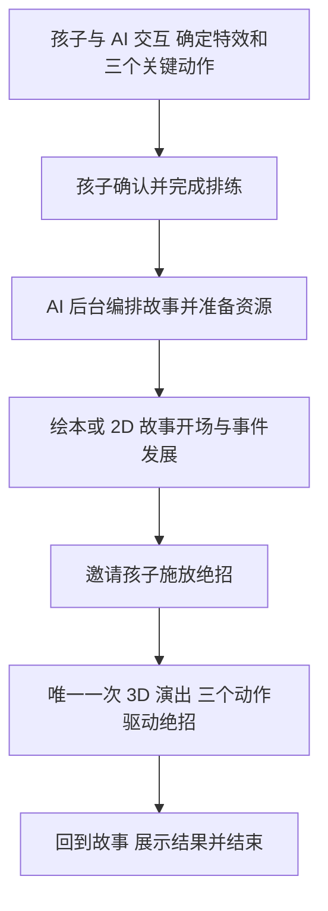

# 儿童与 AI 共创故事及互动演出产品需求

完整产品先让孩子在设定好的创作框架内与 AI 交互，确定特效和三个关键动作，再作为演出嘉宾亲自参与故事。孩子确认创作后，AI 在后台将其编排进故事。故事可以采用绘本或 2D 动画，在“绝招释放”环节进入唯一一次实时 3D 演出，由摄像头捕捉孩子的身体动作，驱动同一位英雄完成绝招，然后返回故事并结束。

产品同时承载两种参与：创作时，孩子决定英雄如何行动、绝招如何表现；播放时，孩子用身体让这些创作发生。AI 负责追问、整理、预览反馈与故事衔接，让孩子的输入成为可看见、可表演的结果。

版本 v0.4，2026 年 10 月 11 日。完整项目依次交付实时演出基础、创作工具、AI 共创、故事编排、混合播放和儿童试用。两人四小时 Demo 是第一阶段的验证节点。完整产品支持孩子自定义动作和特效；该验证先用三个固定动作与能量球。识别阈值、过渡时长和性能指标均作为首轮调试目标。

实施顺序、阶段产物、验收条件与双人分工见 [项目阶段与双人协作](PROJECT_STAGES_v0.4.md)。协作准备与现有工程衔接已结合 Neural Marionette Next 交接手册整理。

## 完整产品的创作框架

故事遵循固定的演出结构：出现困难 → 展开事件 → 邀请孩子驱动英雄释放绝招 → 展示结果并结束。首个主题为“接住掉下来的月亮”；其他主题可在后续扩展。

| 孩子可以决定 | 产品提供的框架 |
| --- | --- |
| 英雄的名字、设定和可用形象 | 同一角色具有可连续识别的故事形象与 3D avatar |
| 三个关键动作及其连接方式 | 按顺序完成三个动作节点，具备可识别和可排练的条件 |
| 绝招名称、外观、颜色、规模与表现方式 | 特效具有出现、发展、释放和作用结果，并能绑定到角色或场景 |
| 对 AI 建议的接受、修改或重试 | 孩子确认后，动作与特效才进入故事编排 |

自由度来自框架内的创作与修改。完整产品需要将孩子描述的特效转成可在 3D 舞台执行的资源与参数；预览应忠实展示最终能演出的效果。遇到当前能力无法表达的想法，AI 给出可实现的表达让孩子选择，保留原始想法以便继续修改。任意描述直接生成复杂 3D 角色或特效的实现方式仍需单独验证。

## 孩子与 AI 共创的流程

1. **提出想法。** 孩子描述角色的绝招，AI 通过简短追问帮助确定“它长什么样、怎样出现、能做什么”。角色名字与外观可沿用已选设定。
2. **录入动作。** 孩子通过摄像头示范一段动作，从中确认三个关键节点。产品保存可用于识别和重定向的动作数据，并以 avatar 回放供孩子检查。
3. **绑定并预览。** 将三个动作节点分别绑定到特效状态；孩子边做动作边看预览，修改特效大小、颜色、位置、阶段表现或动作本身。
4. **确认创作。** 孩子确认这套“角色、动作、特效”。系统检查三个节点可被识别、特效能顺序完成，再进入后台编排。
5. **准备与开演。** AI 编排故事并准备素材。完成后展示开演入口；孩子观看故事，在绝招释放环节受邀参与一次 3D 表演，完成后返回故事结尾。

动作与特效允许往返修改。三个动作在完整产品中来自孩子输入，在当前 Demo 中由团队固定；这两种范围分别验收。

## AI 后台编排

后台以孩子确认的创作为约束，设计合理的剧情原因、参与邀请和绝招解决问题的过程。输出包括故事片段、播放顺序，以及唯一一次实时 3D 演出的进入和退出条件。

| 输入或输出 | 必须包含的内容 |
| --- | --- |
| 已确认的角色 | 身份、名称、故事形象与可用 3D avatar 的对应关系 |
| 已确认的动作 | 三个动作节点、识别条件、顺序与排练样本 |
| 已确认的特效 | 视觉资源、状态、连续可调参数、空间绑定与释放后的作用结果 |
| 故事编排结果 | 故事片段、台词、场景、一次绝招演出邀请及其前后剧情 |
| 3D 演出配置 | avatar、摄像机、特效、目标物、动作提示、完成条件与恢复方式 |
| 开演检查结果 | 素材就绪、节点配置有效、摄像头准备与故障提示 |

AI 可以为绝招补充故事解释，但保持孩子确认的动作与视觉效果；需要更改时回到共创预览再次确认。绘本、2D 动画片段与 3D 舞台之间通过明确的故事状态衔接，例如“月亮正在下落”和“月亮已被托回天空”。

正式开演前预加载所需资源。演出现场根据已准备好的配置响应动作，故事生成和素材生成不阻塞实时参与。后台失败时保留孩子已经确认的创作，允许重试。

## 一次实时 3D 绝招演出

| 演出节点 | 孩子参与 | 完成后交回故事的结果 |
| --- | --- | --- |
| 绝招释放 | 连续控制 avatar，依次完成三个关键动作并驱动特效 | 绝招已释放，目标产生约定变化，故事进入结果段 |

绝招环节进入真正的实时 3D 演出状态，角色持续跟随孩子的身体。故事主体的绘本或 2D 表现形式不影响这次演出的互动方式。

这次演出依次经历“邀请 → 准备 → 实时演出 → 完成 → 返回故事结尾”。孩子准备好、追踪稳定后才开始识别；等待时舞台保留轻微循环动画，提示用动作示例和简短语言表达。

## 叙事与舞台的衔接

角色在绘本、2D 和 3D 中保留一致的名字、主体颜色、轮廓与标志物，孩子能够认出这是自己创造的同一位英雄。转场延续场景里的关键物体、绝招配色、声音与情绪；首版完整流程可用镜头靠近、光效或翻页完成舞台切换。

摄像头准备安排在开演前。到达参与节点时，故事暂停在邀请或等待状态，直到孩子完成表演。未准备好、暂时离开镜头或识别丢失时，保留当前节点并提供重试；由孩子或陪同者明确选择示范或跳过后，才按预先准备的替代结果继续，并保留“示范”标识。

绝招演出每轮只产生一次完成信号。故事播放器根据结果进入结尾，防止重复返回或重复触发。绝招释放后，能量接触目标并完成作用，再衔接故事的结果画面；表演过程中随意摆动双手不会改变已经确认的故事结局。

## 完整产品的验收目标

- 孩子可以修改动作或特效并重新预览，确认后的版本被用于后台故事编排和正式演出。
- 一个绘本或 2D 故事只包含一次 3D 绝招演出，完成后顺利返回故事并结束。
- 演出中 avatar 持续响应身体，并能识别孩子事先确认的三个动作。
- 剧情能解释绝招如何解决困难，实际特效与孩子确认的预览相符。
- 孩子慢做、暂停或短暂出画时，故事等待并可恢复；示范或跳过需明确选择。
- 开演前资源准备失败可重试，已确认的创作得以保留；正式参与时不等待 AI 临时生成。

以上描述完整产品目标。工程交付按六个阶段推进：

| 阶段 | 完成后的能力 |
| --- | --- |
| 1 实时演出基础 | 身体持续驱动 avatar，三个动作推进特效并产生场景结果 |
| 2 动作与特效创作工具 | 录入、编辑、预览、确认、保存并重新打开一份作品 |
| 3 AI 共创交互 | AI 帮助孩子生成和修改配置，预览与确认版本一致 |
| 4 故事编排与资源准备 | 从确认作品生成可播放故事、媒体资源和演出配置 |
| 5 故事与 3D 演出整合 | 从故事进入一次真人绝招演出，再回到故事结尾 |
| 6 儿童试用与迭代 | 在目标设备上验证理解、完成、恢复与再次创作的体验 |

后续阶段可先用人工配置与占位素材并行搭建，正式验收时接入前序阶段的真实产物。阶段五完成首个完整产品版本，阶段六依据试用持续改进。下文保留阶段一的四小时验证范围与具体要求。

## 阶段一的四小时验证范围

Demo 聚焦绝招释放这一处 3D 演出的技术验证：孩子站在摄像头前，avatar 连续跟随身体，三个固定动作依次控制能量球的聚集、变大和释放，最终托起月亮。完整产品的 AI 共创、后台串故事，以及进入和退出这次演出的跨媒介转场后续接入。

### Demo 产品边界

采用 brainstorming 的方案①“身体塑造特效”为主方案，方案③“身体触发预制动画片段”为备选附加项。

- 一个表演者、一个摄像头、一个 3D avatar、一套绝招、一个月亮目标。
- 三个动作固定为“胸前聚拢 → 双手拉开 → 双手上推”，首版由团队定义。
- 全身主要关节连续驱动角色，特效同时响应手的位置与间距；三个动作节点负责切换阶段。
- 预制的是特效的视觉形式、运动规则和可选动画片段。演出时，身体决定参数和阶段开始的时机。
- 月亮作为绝招产生作用的明确目标。村庄、完整剧情与 AI 对话不占用核心演出的开发优先级。
- AI 对话属于演出前准备。现场核心链路使用已加载的素材与配置。

这里的“三个关键帧”指三个可辨认的演出状态。节点之间有连续反馈和过渡；主方案采用特效参数控制，不要求身体逐帧控制整条动画时间线。

### Demo 现场体验

操作员开启摄像头，完成站位与居中。屏幕同时呈现角色舞台、小幅摄像头预览和当前动作提示。表演者先自由抬手、侧倾、屈膝，展示身体与角色的对应关系，然后开始三个动作。

| 步骤 | 表演者看到的提示 | 舞台反馈 |
| --- | --- | --- |
| 准备 | 站入画面，跟英雄一起动 | avatar 连续跟随；月亮停在等待位置 |
| 聚拢 | 双手在胸前靠近 | 两手之间出现小能量球 |
| 拉开 | 慢慢拉开双手 | 球随双手移动并逐渐变大，粒子运动增强 |
| 上推 | 把能量送向月亮 | 能量球从手间释放，飞向月亮 |
| 收尾 | 接住月亮了 | 能量展开并托起月亮，出现完成反馈 |
| 再来一次 | 重新开始 | 月亮、能量与动作阶段复位 |

一次演示可安排约 30～60 秒。等待下一动作的阶段由表演者决定时长；释放后的收尾按预设节奏完成。

### 身体与角色的对应

动作重定向负责把人体关节的方向转换为角色骨骼的旋转，保留角色自身的身体比例。主要覆盖肩、肘、腕、髋、膝、踝，以及躯干朝向与倾斜；头部以现有骨架和可用识别信息为限。

全身关节可见时，屈膝、抬膝和身体侧倾应在角色上可辨认。下半身出画时，下肢平滑保持或回到稳定站姿，上半身仍可完成三个施法动作。此状态在操作界面标明“上半身追踪”。

镜像预览与角色映射采用一致的规则。左右肢体不会随识别帧变化互换，手臂与腿部长度保持稳定，关节变化进行平滑处理。单摄像头估计存在深度与遮挡误差，首版表演面向摄像头，以清晰可见的大幅动作验证自然程度。

特效应从渲染后 avatar 的双手锚点计算位置，避免平滑后角色手掌与能量球分离。真人关键点用于动作判断，角色锚点用于舞台中的特效位置。

### 三个固定动作与连续控制

| 动作节点 | 识别规则 | 对应状态 |
| --- | --- | --- |
| K1 胸前聚拢 | 双手进入胸前区域，间距较小，并短暂稳定 | 进入蓄力，小能量球出现 |
| K2 双手拉开 | K1 后手间距增大，达到展开范围，双手保持在可见的施法区域 | 进入就绪，大能量球稳定成形 |
| K3 双手上推 | K2 后两手均明显上移，越过相对身体的释放高度 | 进入释放，锁定起点并脱离双手 |

胸前区域、展开距离和释放高度使用肩宽、躯干长度等身体比例归一化；避免用固定屏幕像素决定不同身高、远近的成功条件。动作判定包含前后阶段和运动变化，仅在启动时已经举高手不会直接释放。

蓄力期间，球心持续跟随双手中点；手间距决定半径，半径有上下限；粒子速度或亮度随蓄力规模增加。K2 完成后保持已达到的球体规模，方便双手转向上推。阶段确认锁定，手重新靠近不会退回上一阶段。

K3 确认时保存能量球的位置和尺寸。释放方向保留向上托举的观感，终点固定为月亮；随后双手自由移动，已释放的能量独立完成飞行、接触、托举。

默认顺序为“等待 → 蓄力 → 就绪 → 释放 → 完成”。每个节点每轮只确认一次，阶段转换连续过渡。首轮稳定判定时长建议从约 0.2～0.35 秒调起，以真人试演结果调整。

### 预制片段的附加方式

主方案已经包含基础的飞行、接触和托举收尾。附加预制片段可以增强关键节点的观感，例如 K1 的蓄力闪光、K2 的光环展开、K3 的释放冲击波或更丰富的托举动画。

每段素材明确进入动画、等待循环、退出或收尾，以及绑定位置。K1 和 K2 素材跟随双手中点或角色根部；K3 释放后固定在场景坐标中。三段素材继续使用同一组动作，不增加新的动作学习成本。

播放片段时 avatar 继续跟随身体。若片段需要播完才能进入下一阶段，先锁住阶段切换；播放结束后重新检查当前动作，不缓存过期触发。素材缺失、加载失败或未启用时，基础能量球演出仍可完整结束。

守护兽、复杂召唤与额外角色属于素材充足后的扩展，不是首版验收前提。

### 稳定性与恢复

- 手部或上半身追踪短暂丢失时，保持最后可靠的角色姿态和能量状态，暂停动作确认，清空尚未完成的稳定计时。持续丢失时显示“让双手回到画面”；再次稳定识别后平滑恢复。
- 释放前，识别恢复不会自动越过节点。释放后，能量与月亮的收尾独立完成，即使表演者暂时离开画面。
- 不符合当前阶段的动作只保留身体跟随，不跳到后续特效阶段；完成后保持结束状态，直到操作员重新开始。
- 月亮在等待动作期间保持安全的等待位置，避免表演者动作较慢时剧情自行失败。
- 页面保留重新居中、重新开始与明确标注的自动演示入口。自动演示用于检查素材与展示保底，真人跟随能力以摄像头试演验收。
- 首版摄像头画面在本地处理。录制、上传与长期存储不属于核心演出要求。

### Demo 开发范围与优先级

| 优先级 | 交付内容 |
| --- | --- |
| P0 必须完成 | 角色加载、身体连续跟随、三个顺序节点、手间能量球连续控制、释放托月亮、追踪恢复和一键重置 |
| P1 完成 P0 后追加 | 方案③预制片段、配套音效与镜头变化、简化村庄背景 |
| P2 后续 | 自定义动作模板、动作录制回放、AI 对话编辑、任意绝招素材生成、完整短片与视频导出 |

此处优先级仅适用于当前 Demo。完整产品中的动作录入、AI 共创、后台故事编排，以及一次 3D 绝招演出和前后转场，均属于完整体验的组成部分；视频导出与任意素材生成另行评估。

全身跟随是目标；上半身跟随是拍摄空间或下肢追踪不足时的演示降级。若只能展示上半身，验收记录明确标为部分达成。仅识别姿势再播放角色固定动作，不能作为连续骨骼跟随已完成的依据。

现有工程可从 stick-avatar 的识别链路与 neural-marionette-next 的鹿角机甲资产衔接；aiforkids 工作区中的 energy-avatar 已有方案①原型。Next 手册描述的是手部控制基线，身体识别、重定向和新产品流程按各阶段新增或适配。双方先对齐共享仓库与提交，再整合原型；功能完成情况按下面的实测标准确认。

技术分层为：摄像头识别 → 身体骨骼与置信度 → 角色动作重定向；同一份身体数据进入动作阶段控制，输出阶段事件。特效接收角色双手锚点、手间距、阶段事件与月亮位置；预制片段复用这些事件。

当前 Demo 的实时演出不依赖模型 API。完整产品接入火山引擎时，需准备文本模型 Endpoint ID、请求地址、API key 和调用文档，支持共创对话、结构化特效配置及故事编排。绘本图像、2D 动画和其他素材生成按最终表现形式选择接口；具体模型与素材生成方式尚未确定。

### 两人四小时交付安排

以下为四小时开发预算的分配，不代表当前剩余时间。

| 时间 | 动作与角色负责人 | 特效与演出负责人 | 汇合结果 |
| --- | --- | --- | --- |
| 第 1 小时 | 验证角色骨架与上半身映射，试验腿部跟随 | 完成能量球与月亮基础场景，用模拟参数调效果 | 角色可跟随，特效可独立预览 |
| 第 2 小时 | 接入三节点识别与遮挡恢复 | 接入手锚点、间距与阶段事件 | 真人能聚拢、拉开、上推 |
| 第 3 小时 | 调镜像、平滑、不同站位与身高 | 打磨释放、接触、托举和重置 | 完整完成一轮救月亮 |
| 第 4 小时 | 摄像头重复试演与修复 | 完成反馈；有余量再接方案③ | 可重复现场展示 |

尽早约定双手锚点、追踪有效性、阶段事件、释放起点与重置信号。第三小时若核心链路尚未闭合，集中完成 P0；预制片段保留可选入口。

### Demo 验收标准

验收使用目标电脑、目标浏览器和真实摄像头；自动演示用于辅助检查。以下均为目标，需在试演后记录结果。

| 检查项 | 通过条件 |
| --- | --- |
| 连续身体跟随 | 单侧抬手、屈肘、侧倾、屈膝、抬膝可辨认；左右不交换，肢体不持续拉伸或突然翻转 |
| 三节点顺序 | 聚拢、拉开、上推各触发一次；跳过聚拢直接举手不释放 |
| 连续特效控制 | 蓄力时移动双手，球跟随；缓慢拉开双手，球连续变大；停住时不自行进入下一阶段 |
| 释放与因果关系 | 能量从角色双手位置离开，接触月亮后才开始托举；此后移动双手不拖回已释放的能量 |
| 追踪恢复 | 蓄力时短暂遮住手再恢复，阶段不跳变，能继续完成；释放后离开画面，收尾正常结束 |
| 下半身降级 | 腿部出画时明确显示上半身追踪，施法仍可完成；全身验收单独记录 |
| 重复演出 | 连续完成三轮，每轮重置后月亮、能量尺寸、动作阶段和可选片段均归位 |
| 可选素材 | 关闭方案③仍可完成 P0；开启后片段只播放一次，切换无突兀位置跳变 |

首轮性能目标：在目标演示机上争取稳定约 30 FPS，身体动作到画面反馈的可感知延迟约 200 毫秒以内。实测若未达到，优先降低粒子数量和画面负载；记录测试方式、设备和结果后再调整目标。

## 决策依据

完整产品已确定：先在框架内由孩子与 AI 交互确定特效和三个关键动作，确认后进入 AI 后台串故事；正式故事只在绝招释放时切入一次实时 3D，邀请孩子通过身体驱动角色表演，随后返回原有叙事形式并结束。

当前 Demo 已确定：两人四小时、月亮主题、现场绝招演出优先、三个动作先固定。该范围用于阶段一的检查点，完整项目的交付按六阶段推进。

[brainstorming](thread://01a129b1-0a23-7402-b28d-6fa7560a693a?hostId=local) 中的选择为“先做 1，3 作为备选附加项”。本文据此将“彩虹能量球”作为主绝招，把身体触发预制片段保留为附加能力。
