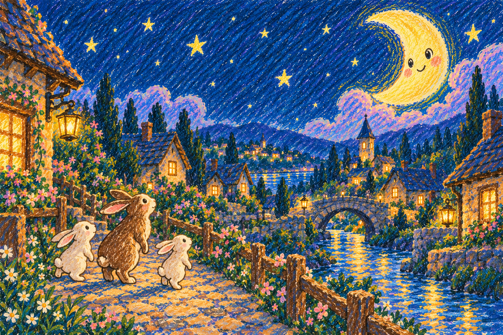
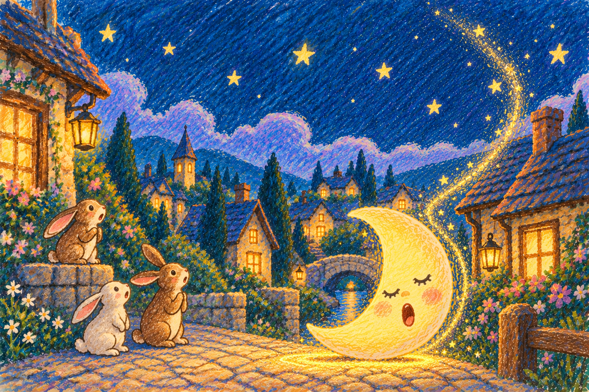
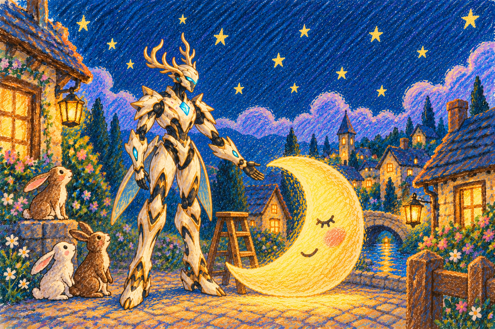
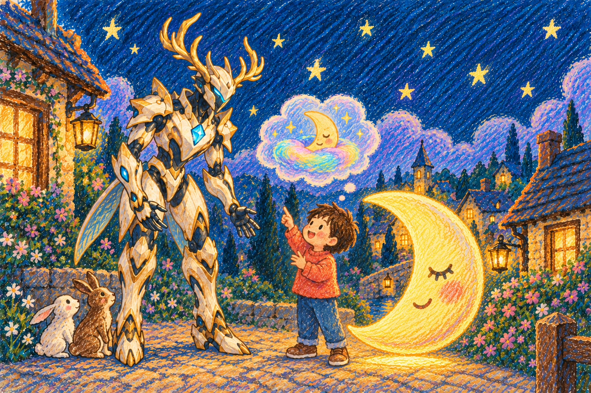
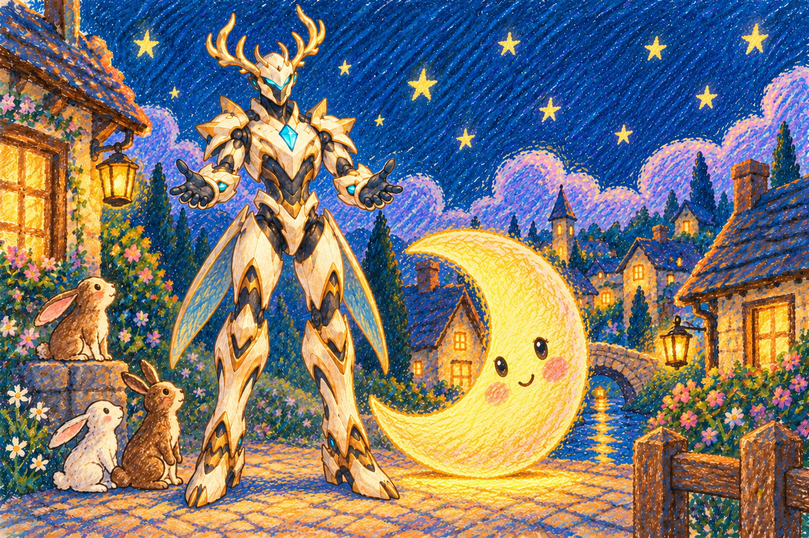
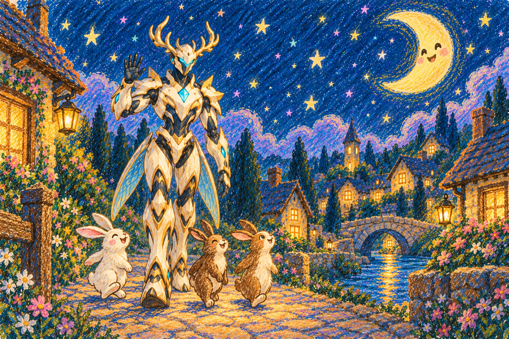

# 把月亮轻轻送回家

> **旧画稿，仅用于历史对照与旧播放器验证。** 最新定稿为月亮落在村外山谷、村庄变暗、小动物求助贾维斯、第5页英雄特写邀请；不出现独立人类孩子。新版尚待绘制，见 [故事定稿](../../docs/MOON_STORY.md) 和 [结构化分镜](../../docs/moon-story.definition.json)。现有图片及 manifest 不代表新版故事已完成。

蜡笔涂鸦画风，贾维斯／鹿角机甲 V2，5 页正文＋1 页结局。

第 2～5 页已改为月亮落到村庄地面；第 1、6 页月亮在高空，形成明确前后对比。旧图保留，新图使用 -v2 文件名。

这是已生成的素材包与开发 fixture，尚未接入实时生成服务或 3D 舞台。`manifest.json` 的图片路径相对本目录；部署时根据资源根地址解析或转换为 URL。`spellRef` 是共享样例标识，不表示已有真实录入样本。`story-request.json` 记录语义输入，`page-prompts.json` 记录每页场景供后续生成适配器使用。

第 5 页暂停并请求施法；收到同一轮 `moon_restored` 成功结果才显示第 6 页。结局提前准备，现场不等待生成。插图没有内嵌文字，播放器独立显示以下文字。

## 1. 月亮照着小村庄

每个晚上，月亮都会陪大家走过最后一段路。

## 2. 月亮打起了瞌睡

“哎呀！我掉到村庄的小路上了，谁能送我回天空？”

## 3. 贾维斯想办法

“我们需要一团又大、又轻、又温柔的魔法。”

## 4. 孩子创造了办法

先聚起一点光，再把它变大，最后轻轻送上天空。

## 5. 轮到你来帮忙

准备好了吗？让你的动作变成魔法，把我送回家吧！

## 6. 月亮回家了

谢谢你！今晚，是你的魔法照亮了回家的路。

