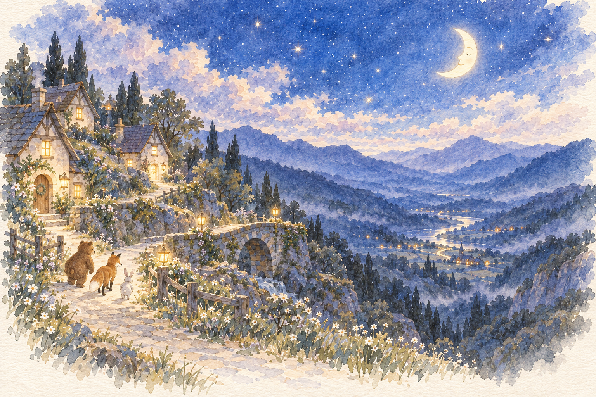
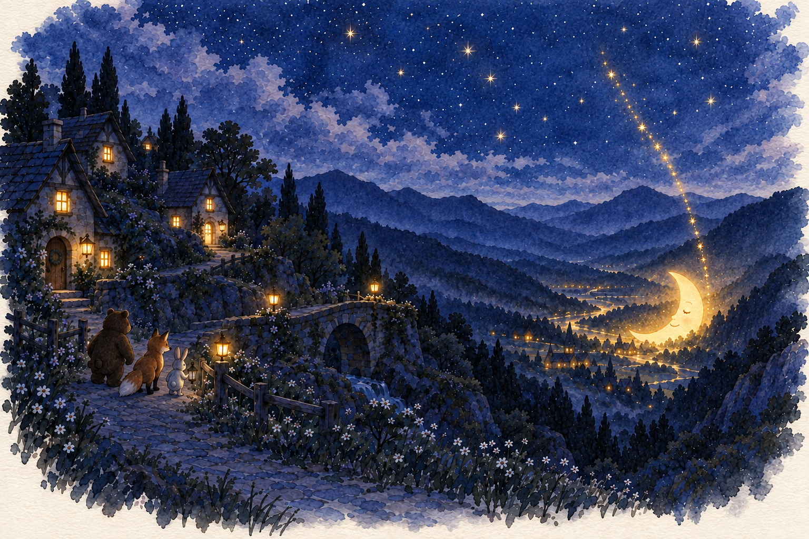
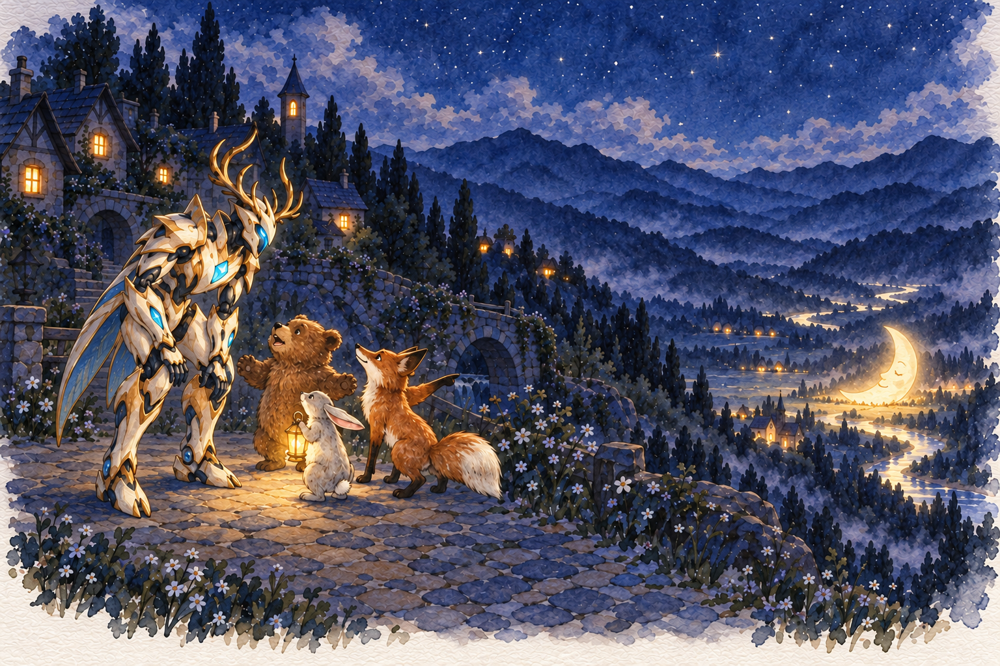
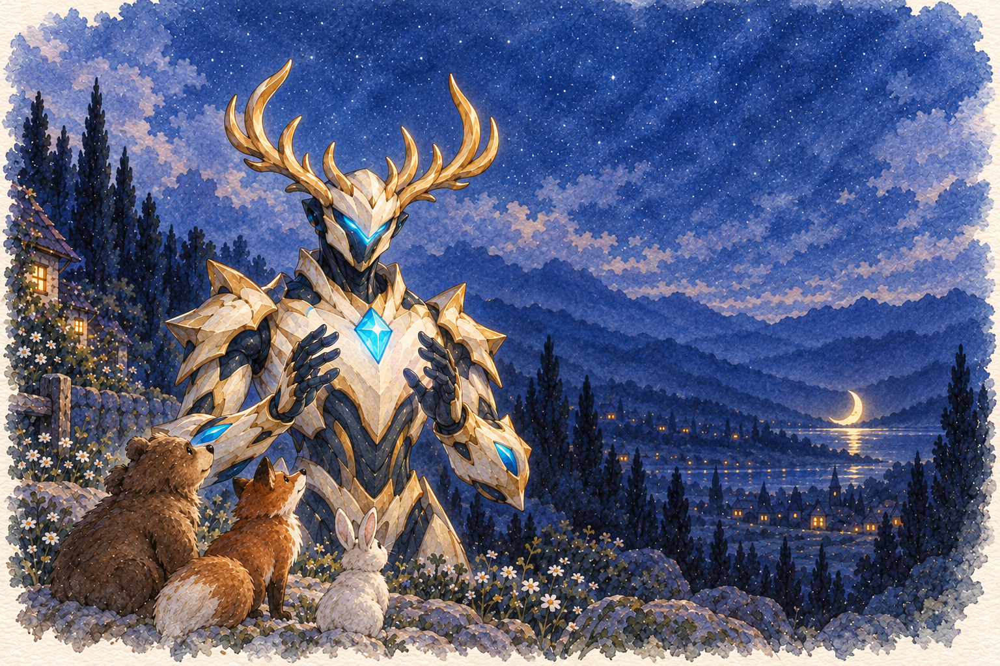
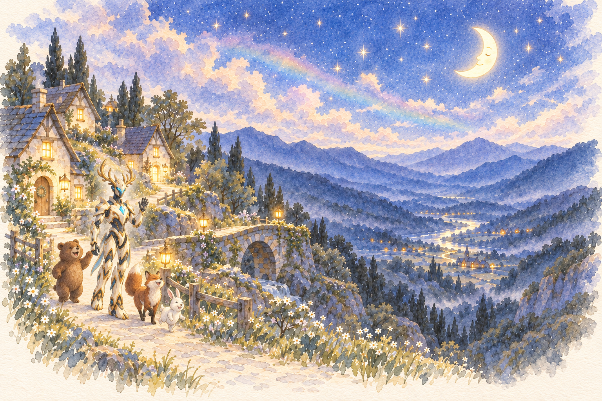

# 把月亮轻轻送回家 · 留白水彩绘本

2026-10-11。依据故事修订 3 重绘，5 页正文＋1 页结局。使用内置 image_gen 生成，采用「02 留白水彩绘本」参考；角色仍为贾维斯。旧素材包不覆写。

透明水彩、淡靛蓝与薰衣草夜色、柔和金色月光、纸面留白。文字独立排版，无独立人类孩子。村庄在近处山坡，掉落月亮在远处谷底。第 1、2、6 页形成亮→暗→恢复月光的对照。

[打开六页预览](index.html)。播放器使用 [manifest.json](manifest.json)，图片路径相对本目录解析。第 5 页暂停邀请动作，只有本轮实际完成 `moon_restored` 才可在正式体验展示结局。预览页的第 6 页仅用于素材审阅。

[生成提示词与修正记录](generation-prompts.json)。本目录包含角色与画风参考副本，便于复现，不把角色参考当故事页。

## 1. 月光照着村庄

每个晚上，月亮都会照着大家回家。

## 2. 月亮掉进山谷

月亮掉进了山谷，村庄一下子暗了下来。

## 3. 大家搬不动它

推呀，拉呀……月亮太大了，谁也搬不动！

## 4. 小动物向贾维斯求助

贾维斯，请帮帮我们！把月亮送回天空吧！

## 5. 贾维斯准备施法

贾维斯，准备好了吗？聚起能量，把月亮送回家！

## 6. 月光回来了

谢谢你，贾维斯！大家又能看见回家的路了。

